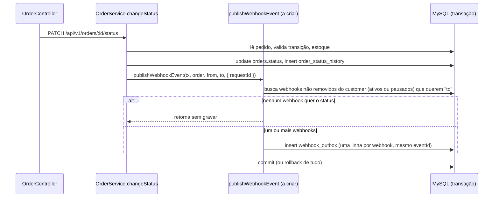
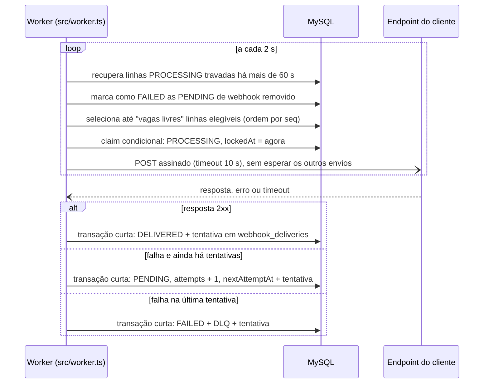

# FDD: Sistema de Webhooks de Notificação de Pedidos

| Campo | Valor |
| --- | --- |
| Status | Em revisão |
| Data | 14/10/2026 |
| Documentos relacionados | [PRD](PRD.md) · [RFC](RFC.md) · [ADRs](adrs/README.md) · [Tracker](TRACKER.md) |

**Como ler este documento.** `[hh:mm] Nome` indica a fala da reunião ([`TRANSCRICAO.md`](../TRANSCRICAO.md)) de onde veio o item. **(proposta)** marca uma escolha deste FDD sobre um ponto que a reunião não decidiu; ela vale até a revisão indicada no [RFC](RFC.md#questões-em-aberto). **(a criar)** marca arquivo, tabela ou rota que ainda não existe no código.

## 1. Contexto e motivação técnica

Os clientes B2B consultam GET /orders periodicamente para descobrir mudanças de status ([09:00] Marcos). A feature troca esse polling por uma notificação ativa, só de saída ([09:02] Marcos), em menos de 10 segundos ([09:02] Marcos).

Hoje a aplicação não tem nenhum mecanismo de evento ou fila. A mudança de status acontece em `OrderService.changeStatus` (`src/modules/orders/order.service.ts`), dentro de `prisma.$transaction`: o método lê o pedido, valida a transição em `src/modules/orders/order.status.ts`, debita ou repõe estoque, atualiza o status e grava `order_status_history`. Essa transação é o ponto de entrada da feature: o evento nasce nela ([09:40] Bruno) e sai por um processo separado. A justificativa de cada decisão está nos ADRs; este documento descreve como construir.

## 2. Objetivos técnicos

| # | Objetivo | Como verificar |
| --- | --- | --- |
| OT-1 | Toda mudança de status que algum webhook quer receber gera um evento na outbox; nenhuma mudança revertida gera evento ([09:06] Diego, [09:40] Bruno) | Teste de integração: transação com falha forçada não deixa linha na outbox |
| OT-2 | O worker começa a primeira tentativa até um intervalo de polling, 2 s ([09:10] Larissa), mais o tempo da própria consulta, depois que o evento fica visível na outbox. Vale quando há vaga no limite de envios simultâneos (seção 4.3) | Espera na fila: `startedAt` da primeira tentativa menos `createdAt` da outbox (relógios e fuso na seção 4.1). A conta parte da inserção, não do commit: inclui o resto da transação de `changeStatus`, porque o instante do commit não é registrado |
| OT-3 | Cliente saudável recebe o evento em menos de 10 s após a mudança de status ([09:02] Marcos) | Métrica `webhook_delivery_latency_seconds`, com o recorte da seção 8 |
| OT-4 | Falha ou timeout de 10 s ([09:42] Diego) agenda as próximas tentativas com intervalos de 1 min, 5 min, 30 min, 2 h e 12 h ([09:17] Larissa) e, esgotadas, move para a DLQ ([09:18] Diego). Contagem de envios conforme a premissa provisória da seção 4.4 | Teste com relógio controlado |
| OT-5 | Todo envio leva assinatura HMAC-SHA256 verificável com a secret do endpoint ([09:22] Sofia) | Teste que recalcula a assinatura com a secret |
| OT-6 | Eventos de um mesmo pedido para um mesmo webhook chegam na ordem de criação, com um único worker ([09:13] Larissa) | Teste com dois eventos do mesmo pedido e falha no primeiro; teste com dois eventos gravados no mesmo milissegundo |
| OT-7 | Nenhum payload acima de 64 KB é enviado ([09:24] Larissa) | Teste com payload inflado |

## 3. Escopo e exclusões

**Incluso.**
- Módulo `src/modules/webhooks` (a criar) com cadastro, edição, remoção e listagem de webhooks por customer ([09:33] Bruno), rotação de secret ([09:21] Sofia) e histórico de entregas ([09:34] Marcos).
- Gravação do evento na transação de `changeStatus` ([09:40] Bruno).
- Worker em `src/worker.ts` (a criar), com retry, DLQ e reprocessamento manual por ADMIN ([09:18] Diego, [09:36] Larissa).

**Fora desta entrega** (detalhe no [PRD](PRD.md)):
- e-mail ao cliente quando o webhook falha ([09:37] Larissa);
- rate limiting de saída ([09:39] Larissa);
- dashboard visual ([09:40] Larissa);
- arquivamento da outbox ([09:08] Diego);
- vários workers em paralelo ([09:13] Diego);
- webhooks de entrada ([09:02] Marcos).

**Evento na criação do pedido (proposta).** `OrderService.create()` cria o pedido já em PENDING e grava a primeira linha de histórico, sem passar por `changeStatus`. Este FDD não gera evento na criação: a reunião tratou de mudança de status ([09:00] Marcos) e da integração em `changeStatus` ([09:40] Bruno). A lacuna está no [RFC](RFC.md#lacunas-identificadas-na-análise-não-discutidas-na-reunião).

## 4. Fluxos detalhados

### 4.1 Modelo de dados (proposta)

As tabelas seguem o padrão do `prisma/schema.prisma`: id `String @id @default(uuid()) @db.Char(36)` ([09:51] Larissa), `createdAt` e `updatedAt` nas tabelas que mudam de estado, nome de tabela em snake_case com `@@map` e nome de campo em camelCase, sem `@map`. É o que o projeto já faz: em `orders`, a coluna física se chama `customerId` (`prisma/migrations/20260519182739_init/migration.sql`). As consultas com `$queryRaw` da seção 4.3 usam esses nomes físicos. Uma migração nova, só aditiva, entra em `prisma/migrations/`.

| Tabela (a criar) | Campos principais | Origem |
| --- | --- | --- |
| `webhook_endpoints` | `id`, `customerId`, `url`, `secret`, `previousSecret`, `previousSecretExpiresAt`, `statuses` (Json), `active`, `deletedAt`, `createdAt`, `updatedAt` | "url + secret + customer_id + estado ativo", nas palavras de [09:21] Bruno; lista de status ([09:33] Marcos); rotação ([09:21] Sofia); `deletedAt` (proposta) |
| `webhook_outbox` | `id`, `seq`, `eventId`, `webhookId`, `orderId`, `eventType`, `payload` (Json), `status` (`PENDING`, `PROCESSING`, `FAILED`, `DELIVERED`), `failureReason`, `attempts`, `replayCount`, `nextAttemptAt`, `lockedAt`, `claimToken`, `requestId` (Text), `createdAt`, `updatedAt` | Estados e índices "no campo de status [...] e em created_at", nas palavras de [09:08] Diego; payload pronto ([09:52] Larissa); `seq`, `failureReason`, `replayCount`, `claimToken` e os índices em `(status, nextAttemptAt)` e `(webhookId, orderId, seq)` (proposta) |
| `webhook_dead_letter` | `id`, `outboxId`, `eventId`, `webhookId`, `payload`, `reason`, `failedAt`, `replayedAt`, `replayedById` | Payload, motivo e timestamp ([09:18] Diego) |
| `webhook_deliveries` | `id`, `outboxId`, `webhookId`, `eventId`, `attempt`, `replayCount`, `success`, `responseStatus`, `responseBody`, `responseTruncated`, `startedAt`, `durationMs`, `errorCode`, `createdAt` | Sucesso ou falha, payload, response e tempo ([09:34] Marcos) |

**Decisões deste modelo (proposta).**
- **Uma linha de outbox por par (evento, webhook)**, todas com o mesmo `eventId`. Assim cada endpoint tem retry, DLQ e reprocessamento próprios. O ponto está como lacuna no [RFC](RFC.md#lacunas-identificadas-na-análise-não-discutidas-na-reunião).
- **`seq` define a ordem.** `seq` é um `BigInt` autoincremental com índice único (o MySQL exige chave para `AUTO_INCREMENT`; se o Prisma 5.22 não aceitar o atributo fora do id, a coluna entra direto no SQL da migração). Diego falou em ordem de `created_at` ([09:12] Diego), mas `createdAt` é `DATETIME(3)` e dois eventos no mesmo milissegundo empatam, e o MySQL não garante a ordem de linhas empatadas. `seq` segue a ordem de inserção sem empate. Para o mesmo pedido, essa ordem acompanha a ordem das transações: o `update` em `orders` trava a linha do pedido, e a inserção na outbox vem depois dele, então a segunda transação só insere depois que a primeira fez commit. O id continua UUID, como Larissa decidiu quando Diego perguntou se a outbox teria "id auto incremental ou UUID" ([09:51] Larissa). `seq` não é identificador, é chave de ordenação. Mesmo assim, usa o autoincremento que Larissa afastou para o id ("Tudo é uuid"), e por isso precisa passar pela sessão de revisão ([RFC](RFC.md#lacunas-identificadas-na-análise-não-discutidas-na-reunião)). A alternativa sem autoincremento é um contador por pedido calculado na própria transação. Ele exige leitura com `SELECT ... FOR UPDATE`, porque uma leitura comum não enxerga as linhas que outra transação acabou de gravar.
- **`statuses` é uma coluna Json** com a lista de `OrderStatus`, como o campo `address` de `customers`. O Prisma não tem lista escalar no MySQL. O filtro da seção 4.2 roda no código, sobre os poucos webhooks de um customer.
- **`FAILED` encerra o ciclo automático de envio.** O motivo fica em `failureReason`. A linha também vai para a DLQ quando o motivo é esgotamento de tentativas ou payload grande demais. Um webhook removido gera `FAILED` sem DLQ. Só o reprocessamento reabre uma linha `FAILED`. A convivência entre o estado "falhou" ([09:08] Diego) e a DLQ em tabela própria ([09:18] Diego) está na tabela de transições abaixo.
- **Remoção é lógica** (`deletedAt`). Outbox, histórico e DLQ continuam apontando para um webhook que existe, e o histórico continua consultável.
- **FK de `webhook_endpoints.customerId` para `customers`** com o comportamento padrão de restrição, igual ao de `orders.customerId`. Um customer com webhook não pode ser removido, como já acontece com quem tem pedido.
- **O payload fica só na outbox e na DLQ.** O histórico de entregas aponta para a outbox pelo `outboxId`.
- **`responseBody` guarda até 4 KB da resposta**, lidos com limite (seção 4.3), para o histórico não crescer sem controle. `responseTruncated` indica que houve corte.
- **`replayCount`** conta quantas vezes a linha foi reprocessada e é copiado para cada tentativa. Ele separa os envios depois de reprocessamento na medição de latência (seção 8).
- **`seq` fica só no banco.** Ele não sai em resposta da API nem em log, porque é `BigInt` e o `JSON.stringify` do Node não serializa esse tipo.
- **`claimToken`** é um UUID gerado pelo worker a cada claim. A conclusão e a recuperação da tentativa localizam a linha por ele, sem depender de comparar datas (seção 4.3).
- **Relógio e fuso.** O Prisma grava `DateTime` em UTC. `createdAt` e `nextAttemptAt` saem do processo que grava, API ou worker. `lockedAt` sai do MySQL, com `UTC_TIMESTAMP(3)`, que não depende do fuso da sessão. As contas que misturam os dois relógios, como a espera na fila, pressupõem servidores sincronizados por NTP. Este FDD não trata relógio fora de sincronia.
- **Armazenamento da secret** depende da revisão de segurança ([RFC](RFC.md#lacunas-identificadas-na-análise-não-discutidas-na-reunião)). Requisitos mínimos: o worker precisa conseguir ler a secret para assinar; ela não volta em resposta fora da criação e da rotação (proposta); e nunca aparece em log (seção 8).

**Transições da outbox (proposta).**

| De | Condição | Para | Grava junto, na mesma transação |
| --- | --- | --- | --- |
| (inserção) | Payload até 64 KB | `PENDING`, `attempts = 0` | Linha da outbox |
| (inserção) | Payload acima de 64 KB | `FAILED`, `failureReason = WEBHOOK_PAYLOAD_TOO_LARGE` | Linha na DLQ |
| `PENDING` | Claim do worker (seção 4.3) | `PROCESSING`, `lockedAt` e `claimToken` preenchidos | Nada |
| `PROCESSING` | Resposta 2xx | `DELIVERED` | Tentativa em `webhook_deliveries` |
| `PROCESSING` | Falha com tentativa restante | `PENDING`, `nextAttemptAt` pelo backoff | Tentativa em `webhook_deliveries` |
| `PROCESSING` | Falha na última tentativa | `FAILED`, `failureReason` = código do erro | Tentativa em `webhook_deliveries` e linha na DLQ |
| `PROCESSING` | Presa há mais de 60 s | Mesmo destino de uma falha, com `WEBHOOK_DELIVERY_INTERRUPTED` | Tentativa em `webhook_deliveries` |
| `PENDING` | Webhook removido | `FAILED`, `failureReason = WEBHOOK_DELETED` | Nada: não houve envio nem vai para a DLQ |
| `FAILED` com linha na DLQ ainda não reprocessada | Reprocessamento por ADMIN, exceto se o motivo é `WEBHOOK_PAYLOAD_TOO_LARGE` (responde 422) ou se o webhook foi removido (responde 404) | `PENDING`, `attempts = 0`, `failureReason` nulo, `replayCount + 1` | `replayedAt` e `replayedById` na DLQ |

`DELIVERED` não sai mais desse estado. Uma linha reprocessada percorre a tabela de novo e, se esgotar outra vez, gera uma linha nova na DLQ.

### 4.2 Criação do evento na outbox



1. `changeStatus` chama `publishWebhookEvent(tx, order, fromStatus, toStatus)` ([09:41] Bruno) depois de gravar o histórico e antes de reler o pedido. A função recebe o client da transação, então grava no mesmo commit ([09:41] Diego). O quinto parâmetro, opcional, leva o `requestId` (ver abaixo).
2. A função busca os webhooks do `order.customerId` com `deletedAt` nulo e filtra, no código, os que têm `toStatus` na lista `statuses`. Se não sobrar nenhum, não grava nada ([09:34] Bruno). Webhook pausado (`active = false`) também recebe o evento na outbox, e quem segura o envio é o worker (seção 4.3). A reunião só citou o estado ativo na configuração ([09:21] Bruno); acumular os eventos durante a pausa é **proposta** deste FDD, para o cliente não perder mudanças enquanto pausa a integração.
3. Monta o payload uma vez ([09:52] Larissa), com `to_status = toStatus`. O objeto `order` lido no início de `changeStatus` é anterior ao update, então o campo de status dele não serve.
4. Gera um `eventId` UUID ([09:25] Diego) com a biblioteca `uuid`, que já está no `package.json`.
5. Confere o tamanho do payload serializado. Com os campos da seção 5.2 e sem `items`, ele fica em poucas centenas de bytes, então o limite de 64 KB ([09:24] Larissa) funciona como guarda. Se passar, a linha entra na outbox já como `FAILED` e, na mesma transação, entra na DLQ com `reason = WEBHOOK_PAYLOAD_TOO_LARGE` **(proposta)**. Nada é enviado nem truncado, como Larissa pediu ([09:24] Larissa), e a mudança de status não é desfeita.
6. Insere uma linha em `webhook_outbox` por webhook, com `status = PENDING`, `attempts = 0`, `nextAttemptAt = now()` e `requestId`.
7. Devolve a lista de pares `eventId` e `webhookId` gravados **(proposta)**. `changeStatus` só loga `webhook_event_enqueued` com esses pares depois que `prisma.$transaction` resolve, para não registrar evento de uma transação que deu rollback.
8. Qualquer exceção na função propaga. `prisma.$transaction` faz rollback de tudo, inclusive da mudança de status ([09:40] Bruno), e a API responde 500 pelo `errorMiddleware`.

**`requestId` (proposta).** A assinatura que Bruno propôs tem quatro parâmetros ([09:41] Bruno). Este FDD acrescenta um quinto, opcional: `{ requestId?: string }`. Ele chega assim:
- `OrderController.changeStatus` passa `req.id`, gerado ou aceito por `src/middlewares/request-logger.middleware.ts`;
- `changeStatus` ganha o parâmetro opcional `requestId` e o repassa ao publisher;
- o publisher grava o valor inteiro na coluna `requestId` (Text, sem índice).

O middleware aceita o `X-Request-Id` do cliente sem limite próprio, e o limite de tamanho de header do Node já barra valores absurdos. Gravar sem corte mantém o mesmo valor no log `http_request` da API, na outbox e nos logs do worker. Assim, a busca pelo id original encontra todos eles.

### 4.3 Processamento pelo worker



1. **Envios simultâneos e ciclo (proposta).** O worker mantém no máximo 10 envios em andamento, a leitura deste FDD para "batch pequeno" ([09:08] Diego). A cada 2 s ([09:09] Diego), o ciclo calcula as vagas livres (10 menos os envios em andamento). A recuperação de linhas travadas e o encerramento das linhas de webhook removido rodam em todo ciclo. Se não houver vaga, o ciclo para aí e não busca linhas para enviar. Se houver, seleciona até esse número de linhas, faz o claim e dispara cada envio sem esperar os outros terminarem. Quando um envio termina, a vaga fica livre para o ciclo seguinte. Um cliente lento ocupa uma vaga, não o ciclo inteiro. O ciclo nunca roda em paralelo consigo mesmo: o próximo é agendado só depois que a parte de banco do anterior termina.
2. **O que a meta de 2 s cobre.** São três tempos diferentes:
   - o intervalo de polling: 2 s;
   - a espera na fila: do `createdAt` da outbox até o `startedAt` da primeira tentativa;
   - a duração do HTTP: até 10 s.

   Com vaga livre, a espera na fila fica em até um intervalo de polling mais o tempo da consulta (OT-2). Se 10 endpoints lentos ocupam todas as vagas, um evento novo espera a primeira vaga liberar e o ciclo seguinte, o que pode levar até 10 s do timeout mais 2 s do ciclo. As conclusões gravam em paralelo, então o pool de conexões do Prisma no worker precisa comportar 10 transações curtas mais o ciclo; se a máquina for pequena, ajusta-se o `connection_limit` da URL de conexão do worker. A reunião não deu volume de eventos, então o limite de 10 é ponto de partida. A métrica de idade do pendente mais antigo (seção 8) mostra quando ele precisa subir.
3. **Seleção e ordem por pedido (proposta).** A consulta usa `$queryRaw`, com estas condições antes do `LIMIT`:
   - a linha está em `status = 'PENDING'` e com `nextAttemptAt <= UTC_TIMESTAMP(3)`;
   - o webhook dela está ativo (`active = true`) e não removido (`deletedAt IS NULL`); o filtro de pausa vem antes do `LIMIT`, para linhas pausadas não ocuparem as vagas para sempre;
   - não existe outra linha do mesmo `(webhookId, orderId)` com `seq` menor em `PENDING` ou `PROCESSING` (`NOT EXISTS`, apoiado no índice `(webhookId, orderId, seq)`).

   A ordenação é `ORDER BY seq`. A ordem de `created_at` que Diego citou ([09:12] Diego) vira ordem de `seq`, que é a mesma ordem de inserção, sem empate. Sem a regra do `NOT EXISTS`, um evento em backoff seria ultrapassado pelo seguinte do mesmo pedido, e a ordem de [09:13] Larissa se perderia. Limite conhecido: um evento reprocessado da DLQ chega depois dos eventos seguintes do mesmo pedido que já tinham sido entregues. Se um evento seguinte estiver em envio na hora do reprocessamento, os dois podem chegar fora de ordem.
4. **Webhook removido (proposta).** No início do ciclo, um update marca como `FAILED`, com `failureReason = WEBHOOK_DELETED`, as linhas `PENDING` de webhooks com `deletedAt` preenchido. Esse passo não depende da seleção de envios, que só olha webhooks ativos. Uma linha que estava em envio na hora da remoção termina o envio; se falhar e voltar a `PENDING`, o passo do ciclo seguinte a encerra.
5. **Claim, linha a linha (proposta).** O worker gera um `claimToken` (UUID) e roda `UPDATE webhook_outbox o JOIN webhook_endpoints e ON e.id = o.webhookId SET o.status = 'PROCESSING', o.lockedAt = UTC_TIMESTAMP(3), o.claimToken = ? WHERE o.id = ? AND o.status = 'PENDING' AND o.nextAttemptAt <= UTC_TIMESTAMP(3) AND e.active = true AND e.deletedAt IS NULL`. O claim confere de novo o vencimento e o webhook, então uma seleção antiga não antecipa um retry nem envia para webhook pausado ou removido depois da seleção. Se nenhuma linha for afetada, o worker pula. O desenho continua sendo de um único worker ([09:12] Diego). O claim evita que duas consultas peguem a mesma linha ao mesmo tempo, mas não garante ordem nem ausência de duplicata com dois workers rodando. Esse cenário não está no escopo (RFC, questão 3).
6. **Requisição.** POST para a `url` atual do webhook, com o corpo e os headers da seção 5.2, usando `fetch` nativo com `AbortSignal.timeout(10_000)` ([09:42] Diego) e `redirect: 'manual'` **(proposta)**. Uma resposta 3xx conta como falha; seguir o redirect permitiria trocar o `https` cadastrado por `http` ([09:23] Sofia). O Node 20, exigido pelo `package.json`, já traz essas APIs. Nenhuma dependência nova.
7. **Leitura da resposta (proposta).** O status HTTP decide o resultado assim que os headers chegam, e `durationMs` mede até esse momento, que é o tempo de resposta do cliente: 2xx é sucesso; qualquer outra resposta, timeout ou erro de rede é falha (a reunião não distinguiu 4xx de 5xx). O corpo é lido em stream, pelo `response.body`, até 4 KB, e o restante é cancelado com `reader.cancel()`. A leitura fica sob o mesmo timeout de 10 s. Se o corpo falhar ou estourar o tempo depois de um 2xx, a tentativa continua sendo sucesso, e o histórico guarda o que foi lido, com `responseTruncated = true`. Nada lê o corpo inteiro para cortar depois. A vaga fica ocupada até a leitura terminar, no máximo pelo mesmo timeout.
8. **Conclusão da tentativa (proposta).** O resultado de cada envio é gravado numa transação curta, fora do HTTP. A transação começa lendo a linha com `SELECT ... FROM webhook_outbox WHERE id = ? AND status = 'PROCESSING' AND claimToken = ? FOR UPDATE`. Se não achar, a linha já foi recuperada como travada (passo 9): nada é gravado, e o worker loga o descarte. Se achar, grava a linha em `webhook_deliveries` (`startedAt` = `lockedAt` lido, `durationMs` medido no processo) e atualiza a outbox (estado, `attempts`, `nextAttemptAt`, `failureReason`, `lockedAt` e `claimToken` nulos). A DLQ entra na mesma transação quando a tentativa é a última. Cada envio tem o próprio tratamento de erro, separando falha HTTP de falha ao gravar o resultado; o worker não depende de um `catch` geral do ciclo. Se o cliente respondeu 2xx e a gravação falhou, a linha fica em `PROCESSING` e volta pelo passo 9 como tentativa interrompida: o cliente recebe de novo, o que o at-least-once já prevê ([09:24] Diego). Se a gravação falhar sempre, por exemplo com o banco fora do ar, até um evento que o cliente aceitou pode chegar à DLQ; o reprocessamento manual resolve. Não há atomicidade entre o HTTP e o MySQL.
9. **Linhas travadas (proposta).** No início de cada ciclo, linhas em `PROCESSING` com `lockedAt` há mais de 60 s (timeout de 10 s mais margem) contam como tentativa falha, pela mesma transação do passo 8. A tentativa recebe `errorCode = WEBHOOK_DELIVERY_INTERRUPTED`, `startedAt = lockedAt` e `durationMs` nulo, porque o processo que mediria a duração morreu. A recuperação lê as linhas travadas e usa o `claimToken` lido de cada uma, como no passo 8, então não sobrescreve trabalho mais novo. Um evento que derruba o worker toda vez chega à DLQ em vez de girar para sempre. O cliente pode receber repetido, o que o at-least-once já prevê ([09:24] Diego).

### 4.4 Retry

| Envio | Quando | Origem |
| --- | --- | --- |
| 1 (original) | No primeiro ciclo após o commit | [09:09] Diego |
| 2 | 1 min após a falha do envio 1 | [09:17] Diego |
| 3 | 5 min após a falha do envio 2 | [09:17] Diego |
| 4 | 30 min após a falha do envio 3 | [09:17] Diego |
| 5 | 2 h após a falha do envio 4 | [09:17] Diego |
| 6 | 12 h após a falha do envio 5 | [09:17] Diego |

**Premissa provisória.** A tabela segue a leitura de 1 envio inicial mais 5 retentativas. A contagem está em aberto (questão 1 do [RFC](RFC.md#levantadas-na-reunião-e-adiadas-ou-não-decididas)). Se ficar em 5 envios no total, sai a última linha.

`attempts` conta envios feitos. `nextAttemptAt = horário da falha + intervalo[attempts]`. Os intervalos ficam como constantes no módulo. A reunião fixou os valores e não pediu que fossem configuráveis.

### 4.5 DLQ e reprocessamento

1. **Ida para a DLQ.** Quando a última tentativa falha, na transação de conclusão (seção 4.3, passo 8), a linha da outbox vai para `FAILED`, com o motivo em `failureReason`, e entra uma linha em `webhook_dead_letter` com `payload`, `reason` (código do último erro, seção 6) e `failedAt` ([09:18] Diego).
2. **Pedido de reprocessamento.** Um ADMIN chama `POST /api/v1/admin/webhooks/dead-letter/:id/replay` ([09:35] Diego). O id vem do log `webhook_moved_to_dead_letter` ou de consulta ao banco. Não ter endpoint de listagem da DLQ é **proposta**: a reunião pediu o reprocessamento e não falou de listagem.
3. **Transação do reprocessamento (proposta).** Só procede se a linha da DLQ tem `replayedAt` nulo e a linha da outbox ainda está `FAILED`. A verificação é um update condicional; se não afetar nenhuma linha, a resposta é 409 `WEBHOOK_ALREADY_REPLAYED`.
   - A linha da outbox volta para `PENDING`, com `attempts = 0`, `failureReason` nulo, `replayCount + 1` e `nextAttemptAt = now()`. O evento volta à outbox como pendente ([09:18] Diego). A linha mantém o `seq` original, então passa na frente de eventos mais novos do mesmo pedido que ainda estejam pendentes.
   - O `eventId` original é mantido: o cliente que já processou o evento descarta a repetição pelo `X-Event-Id` ([09:25] Diego).
   - `replayedAt` e `replayedById` são preenchidos na linha da DLQ.
   - Se o reenvio esgotar as tentativas de novo, nasce uma linha nova na DLQ. Cada linha da DLQ é um esgotamento, e a anterior fica como histórico.
4. **Casos que não reprocessam.** Webhook removido responde 404 `WEBHOOK_NOT_FOUND`. Motivo `WEBHOOK_PAYLOAD_TOO_LARGE` responde 422 com o mesmo código, porque o payload continuaria grande demais.
5. **Auditoria.** Um log `webhook_replay_requested` registra quem pediu ([09:36] Sofia).

### 4.6 Rotação de secret

1. O cliente chama `POST /api/v1/webhooks/:id/secret/rotate` **(proposta de rota; a reunião pediu o endpoint sem definir o caminho, [09:21] Sofia)**.
2. A secret atual vai para `previousSecret`, com `previousSecretExpiresAt = now() + 24 h` ([09:21] Sofia). Uma nova secret é gerada e devolvida uma única vez.
3. Durante a carência, o worker assina com as duas secrets e envia as duas assinaturas no mesmo header, separadas por vírgula **(proposta, pendente da revisão de Sofia; lacuna no [RFC](RFC.md#lacunas-identificadas-na-análise-não-discutidas-na-reunião))**. O cliente separa os valores pela vírgula e aceita o envio se qualquer um bater com a secret que ele tem. Isso precisa estar na documentação do portal ([09:26] Marcos), porque quem compara o header inteiro falha durante a carência. Passadas as 24 h, `previousSecret` deixa de ser usada.
4. **Nova rotação durante a carência (proposta).** Só existe uma secret anterior. Uma nova rotação enquanto `previousSecretExpiresAt` está no futuro responde `409 WEBHOOK_SECRET_ROTATION_IN_PROGRESS`. Assim nenhuma secret perde validade antes das 24 h prometidas ([09:21] Sofia). Descartar a secret mais antiga na hora encurtaria a carência da primeira rotação. A alternativa é guardar várias secrets anteriores, cada uma com o próprio vencimento, ao custo de mais armazenamento e de um header de assinatura que cresce. Efeito colateral: quem desconfia que a secret nova também vazou espera o fim da carência. Esse caso vai para a revisão de Sofia.
5. **Geração (proposta).** 32 bytes aleatórios de `crypto.randomBytes`, em hex. Sofia vai revisar a geração ([09:46] Sofia).

## 5. Contratos públicos

Todas as rotas ficam sob `/api/v1`, como em `src/app.ts`, e exigem `Authorization: Bearer <jwt>` (`authenticate` de `src/middlewares/auth.middleware.ts`). Erros seguem o formato do `errorMiddleware`: `{ "error": { "code", "message", "details?" } }`.

**Onde vai o `customerId` (proposta).** No body, na criação, e na query, na listagem. É o mesmo padrão de `createOrderSchema` e `listOrdersQuerySchema` em `src/modules/orders/order.schemas.ts`. A reunião deixou "no body ou no path" ([09:32] Larissa).

**Permissão.** O CRUD de configuração aceita qualquer role autenticada, por enquanto ([09:37] Sofia). O reprocessamento exige `requireRole('ADMIN')` ([09:36] Larissa). Rotação de secret e histórico de entregas não foram citados nessa fala. Este FDD aplica a eles a mesma regra do CRUD **(proposta)**. O risco é maior aqui: quem rotaciona recebe a secret nova e passa a conseguir assinar envios em nome da plataforma (seção 12).

Role e acesso ao recurso são coisas diferentes. A reunião decidiu qual role usa o CRUD. Ela não decidiu se um usuário pode mexer nos webhooks de qualquer customer. Como `User` não tem vínculo com `Customer` (`prisma/schema.prisma`), hoje qualquer autenticado alcança os webhooks de todos. Isso é consequência identificada nesta análise, não aceite da reunião, e fica pendente da revisão de segurança (seção 12).

**Limite da fronteira ADMIN (dependência herdada).** O `requireRole('ADMIN')` do reprocessamento confere a role do JWT. Só que o cadastro público aceita ADMIN:
- `POST /auth/register` não exige autenticação (`src/modules/auth/auth.routes.ts`);
- o schema aceita `role: 'ADMIN'` no corpo (`src/modules/auth/auth.schemas.ts`);
- `UserService.createUser` grava a role recebida (`src/modules/users/user.service.ts`);
- o login emite o JWT com essa role (`src/modules/auth/auth.service.ts`).

Com a API exposta como está, qualquer pessoa cria uma conta ADMIN. O teste "OPERATOR recebe 403" prova que a rota confere a role. Ele não prova que só administradores legítimos têm a role. O problema é do código existente, que este desafio não altera, e vai para a revisão de segurança ([RFC](RFC.md#lacunas-identificadas-na-análise-não-discutidas-na-reunião)).

### 5.1 Endpoints da API

**1. Cadastrar webhook: `POST /api/v1/webhooks`** ([09:31] Marcos)

```json
{
  "customerId": "6f1c2a7e-3b4d-4e5f-8a9b-0c1d2e3f4a5b",
  "url": "https://integracao.atlas.example/webhooks/pedidos",
  "statuses": ["SHIPPED", "DELIVERED"]
}
```

Resposta `201 Created`. A `secret` é devolvida na criação ([09:31] Marcos); fora daqui, ela só volta na rotação **(proposta)**.

```json
{
  "id": "0b7d9c4e-1a2b-4c3d-9e8f-7a6b5c4d3e2f",
  "customerId": "6f1c2a7e-3b4d-4e5f-8a9b-0c1d2e3f4a5b",
  "url": "https://integracao.atlas.example/webhooks/pedidos",
  "statuses": ["SHIPPED", "DELIVERED"],
  "active": true,
  "secret": "3f9a5c0e…",
  "createdAt": "2026-10-14T12:00:00.000Z",
  "updatedAt": "2026-10-14T12:00:00.000Z"
}
```

Status:
- `400 VALIDATION_ERROR`: corpo inválido, por exemplo um status fora de `OrderStatus`, lista `statuses` vazia ou com valor repetido **(proposta)**;
- `400 WEBHOOK_INVALID_URL`: URL sem `https` ([09:23] Sofia);
- `404 WEBHOOK_CUSTOMER_NOT_FOUND`;
- `401 UNAUTHORIZED`.

Exemplo de erro, no formato do `errorMiddleware`:

```json
{
  "error": {
    "code": "WEBHOOK_INVALID_URL",
    "message": "Webhook URL must use https"
  }
}
```

**2. Listar webhooks de um customer: `GET /api/v1/webhooks?customerId=<uuid>&page=1&pageSize=20`** ([09:33] Bruno)

Sem corpo:

```http
GET /api/v1/webhooks?customerId=6f1c2a7e-3b4d-4e5f-8a9b-0c1d2e3f4a5b&page=1&pageSize=20 HTTP/1.1
Authorization: Bearer <jwt>
```

Resposta `200 OK`, no formato `paginated()` de `src/shared/http/response.ts`, sem `secret`:

```json
{
  "data": [
    {
      "id": "0b7d9c4e-1a2b-4c3d-9e8f-7a6b5c4d3e2f",
      "customerId": "6f1c2a7e-3b4d-4e5f-8a9b-0c1d2e3f4a5b",
      "url": "https://integracao.atlas.example/webhooks/pedidos",
      "statuses": ["SHIPPED", "DELIVERED"],
      "active": true,
      "createdAt": "2026-10-14T12:00:00.000Z",
      "updatedAt": "2026-10-14T12:00:00.000Z"
    }
  ],
  "pagination": { "page": 1, "pageSize": 20, "total": 1, "totalPages": 1 }
}
```

Status:
- `400 VALIDATION_ERROR`: `customerId` ausente ou inválido;
- `401 UNAUTHORIZED`.

**3. Editar webhook: `PATCH /api/v1/webhooks/:id`** ([09:33] Bruno)

```json
{ "statuses": ["PROCESSING", "SHIPPED", "DELIVERED"], "active": true }
```

Resposta `200 OK`, sem `secret`:

```json
{
  "id": "0b7d9c4e-1a2b-4c3d-9e8f-7a6b5c4d3e2f",
  "customerId": "6f1c2a7e-3b4d-4e5f-8a9b-0c1d2e3f4a5b",
  "url": "https://integracao.atlas.example/webhooks/pedidos",
  "statuses": ["PROCESSING", "SHIPPED", "DELIVERED"],
  "active": true,
  "createdAt": "2026-10-14T12:00:00.000Z",
  "updatedAt": "2026-10-14T15:30:00.000Z"
}
```

Status:
- `400 VALIDATION_ERROR`: corpo vazio, campo fora da lista abaixo, `statuses` vazia ou com valor repetido;
- `400 WEBHOOK_INVALID_URL`;
- `404 WEBHOOK_NOT_FOUND`.

**Campos editáveis (proposta).** A reunião disse só "PATCH pra editar" ([09:33] Bruno). Este FDD fecha o contrato assim:
- o PATCH aceita `url`, `statuses` e `active`, e o corpo precisa trazer pelo menos um deles;
- o schema Zod é `.strict()`, então qualquer outro campo responde `400 VALIDATION_ERROR`;
- `customerId` não muda depois do cadastro: transferir um webhook entre customers levaria o histórico e os eventos pendentes de um cliente para outro;
- `secret` só muda pela rotação.

Efeito de cada campo:
- **`statuses`:** vale para eventos novos. O filtro roda na inserção ([09:34] Bruno), e o que já está na outbox segue.
- **`url`:** vale também para os eventos pendentes, inclusive os que estão em backoff, porque o worker lê a URL atual na hora do envio (seção 4.3). A regra cobre o caso comum de o cliente trocar de endereço. A alternativa, congelar a URL na linha da outbox, mandaria os pendentes para um endereço que o cliente abandonou.
- **`active`:** `false` pausa os envios. Os eventos continuam entrando na outbox e saem na reativação.

**4. Remover webhook: `DELETE /api/v1/webhooks/:id`** ([09:33] Bruno)

Sem corpo:

```http
DELETE /api/v1/webhooks/0b7d9c4e-1a2b-4c3d-9e8f-7a6b5c4d3e2f HTTP/1.1
Authorization: Bearer <jwt>
```

Resposta `204 No Content`, sem corpo, como os outros DELETE da API (`src/modules/customers/customer.controller.ts`). Status: `404 WEBHOOK_NOT_FOUND`.

**Semântica (proposta).** A remoção é lógica: preenche `deletedAt`. O webhook deixa de aparecer na listagem e de receber eventos novos. O worker encerra as linhas pendentes dele com `WEBHOOK_DELETED`, inclusive uma que estava em envio e volte para `PENDING` (seção 4.3, passo 4). O histórico continua disponível em `GET /webhooks/:id/deliveries`.

Para só pausar, o caminho é `PATCH` com `active: false`. Os eventos continuam entrando na outbox e são enviados quando o webhook volta a `active: true`.

**5. Rotacionar secret: `POST /api/v1/webhooks/:id/secret/rotate`** (proposta de rota, [09:21] Sofia)

Sem corpo:

```http
POST /api/v1/webhooks/0b7d9c4e-1a2b-4c3d-9e8f-7a6b5c4d3e2f/secret/rotate HTTP/1.1
Authorization: Bearer <jwt>
```

Resposta `200 OK`:

```json
{
  "id": "0b7d9c4e-1a2b-4c3d-9e8f-7a6b5c4d3e2f",
  "secret": "8c1e7b2d…",
  "previousSecretExpiresAt": "2026-10-15T12:00:00.000Z"
}
```

Status:
- `404 WEBHOOK_NOT_FOUND`;
- `409 WEBHOOK_SECRET_ROTATION_IN_PROGRESS`: já existe uma rotação em carência (seção 4.6).

**6. Histórico de entregas: `GET /api/v1/webhooks/:id/deliveries`** ([09:34] Marcos)

Sem corpo:

```http
GET /api/v1/webhooks/0b7d9c4e-1a2b-4c3d-9e8f-7a6b5c4d3e2f/deliveries HTTP/1.1
Authorization: Bearer <jwt>
```

Resposta `200 OK`. São as 100 tentativas mais recentes, da mais nova para a mais antiga, sem paginação: a reunião pediu "os últimos 100" ([09:34] Marcos). O `payload` vem da linha da outbox.

```json
{
  "data": [
    {
      "id": "5e4d3c2b-1a0f-4e9d-8c7b-6a5f4e3d2c1b",
      "eventId": "9a8b7c6d-5e4f-4a3b-2c1d-0e9f8a7b6c5d",
      "attempt": 2,
      "success": false,
      "responseStatus": 503,
      "responseBody": "Service Unavailable",
      "responseTruncated": false,
      "durationMs": 184,
      "errorCode": "WEBHOOK_DELIVERY_HTTP_ERROR",
      "payload": { "event_id": "9a8b7c6d-5e4f-4a3b-2c1d-0e9f8a7b6c5d", "event_type": "order.status_changed" },
      "createdAt": "2026-10-14T12:01:02.000Z"
    }
  ]
}
```

Status: `404 WEBHOOK_NOT_FOUND`.

**7. Reprocessar evento da DLQ: `POST /api/v1/admin/webhooks/dead-letter/:id/replay`** ([09:35] Diego)

Sem corpo. Exige role ADMIN ([09:36] Larissa), com o limite da seção 5 sobre a origem dessa role.

```http
POST /api/v1/admin/webhooks/dead-letter/3c2b1a0f-9e8d-4c7b-6a5f-4e3d2c1b0a9f/replay HTTP/1.1
Authorization: Bearer <jwt de ADMIN>
```

Resposta `202 Accepted` **(proposta: o envio acontece no próximo ciclo do worker, não na requisição)**.

```json
{
  "deadLetterId": "3c2b1a0f-9e8d-4c7b-6a5f-4e3d2c1b0a9f",
  "outboxId": "7f6e5d4c-3b2a-4190-8f7e-6d5c4b3a2f1e",
  "eventId": "9a8b7c6d-5e4f-4a3b-2c1d-0e9f8a7b6c5d",
  "status": "PENDING"
}
```

Status:
- `403 FORBIDDEN`: role diferente de ADMIN;
- `404 WEBHOOK_DEAD_LETTER_NOT_FOUND`;
- `404 WEBHOOK_NOT_FOUND`: o webhook foi removido;
- `409 WEBHOOK_ALREADY_REPLAYED`;
- `422 WEBHOOK_PAYLOAD_TOO_LARGE`.

### 5.2 Envio para o cliente

O envio é `POST <url do webhook>`, com corpo JSON.

**Payload.** Os campos são os que Diego listou ([09:43] Diego), em snake_case como ele os nomeou. Isso é diferente do camelCase da API interna, porque este é o contrato externo.

```json
{
  "event_id": "9a8b7c6d-5e4f-4a3b-2c1d-0e9f8a7b6c5d",
  "event_type": "order.status_changed",
  "timestamp": "2026-10-14T12:00:00.412Z",
  "order_id": "1d2c3b4a-5f6e-4d7c-8b9a-0f1e2d3c4b5a",
  "order_number": "ORD-000123",
  "from_status": "PROCESSING",
  "to_status": "SHIPPED",
  "customer_id": "6f1c2a7e-3b4d-4e5f-8a9b-0c1d2e3f4a5b",
  "total_cents": 125990
}
```

- `timestamp` é o momento da mudança de status, gravado no snapshot **(proposta)**. Diego pediu "timestamp ISO 8601" no payload sem dizer de quê ([09:43] Diego). O momento do envio vai no header `X-Timestamp` ([09:44] Diego).
- A reunião disse "campos básicos da order tipo total_cents" ([09:43] Diego) e não fechou a lista. Este FDD envia só os campos nomeados.
- Não há `items`. Para mais detalhes, o cliente consulta GET /orders/:id ([09:43] Diego).

**Headers.**

| Header | Valor | Origem |
| --- | --- | --- |
| `Content-Type` | `application/json` | [09:44] Diego |
| `X-Event-Id` | `event_id` do evento, igual em todas as tentativas e no reprocessamento | [09:44] Diego |
| `X-Webhook-Id` | id do cadastro de webhook que recebeu o envio | [09:44] Sofia |
| `X-Timestamp` | momento do envio, em ISO 8601 **(formato proposto; Diego pediu ISO 8601 para o campo do payload)**. O header não entra na assinatura; ver a lacuna do [RFC](RFC.md#lacunas-identificadas-na-análise-não-discutidas-na-reunião) | [09:44] Diego |
| `X-Signature` | HMAC-SHA256 do corpo exato enviado ([09:22] Sofia). Formato `sha256=<hex>`; durante a carência de rotação, `sha256=<nova>,sha256=<antiga>` **(formato proposto)** | [09:20] Sofia, [09:44] Diego |

**Resposta esperada do cliente.** Uma resposta 2xx **(proposta)** em até 10 s ([09:42] Diego). O corpo da resposta é ignorado, exceto para o histórico, que guarda até 4 KB (seção 4.3, passo 7).

## 6. Matriz de erros

Os erros do módulo seguem `AppError` (`src/shared/errors/app-error.ts`) com prefixo `WEBHOOK_` ([09:29] Larissa).

**Classes usadas.** As classes de `src/shared/errors/http-errors.ts` são reaproveitadas onde já aceitam código próprio: `BadRequestError`, `ConflictError` e `UnprocessableEntityError`. `NotFoundError` tem código fixo (`NOT_FOUND`), então os erros 404 do módulo estendem `AppError` direto, em `src/modules/webhooks/webhook.errors.ts` (a criar).

Na coluna Origem, a fala citada é a regra; o nome do código, quando não foi dito na reunião, é proposta deste FDD.

**Erros da API**

| Código | HTTP | Classe | Quando | Origem |
| --- | --- | --- | --- | --- |
| `WEBHOOK_NOT_FOUND` | 404 | nova, estende `AppError` | Webhook inexistente ou removido no PATCH, DELETE, rotação, histórico ou reprocessamento | código citado por [09:28] Bruno |
| `WEBHOOK_INVALID_URL` | 400 | `BadRequestError` | URL sem `https` | regra de [09:23] Sofia; código citado por [09:28] Bruno |
| `WEBHOOK_CUSTOMER_NOT_FOUND` | 404 | nova, estende `AppError` | `customerId` inexistente no cadastro | proposta |
| `WEBHOOK_DEAD_LETTER_NOT_FOUND` | 404 | nova, estende `AppError` | Item da DLQ inexistente | proposta |
| `WEBHOOK_ALREADY_REPLAYED` | 409 | `ConflictError` | Item da DLQ já reprocessado, ou linha da outbox que não está mais `FAILED` | proposta |
| `WEBHOOK_SECRET_ROTATION_IN_PROGRESS` | 409 | `ConflictError` | Rotação pedida enquanto a secret anterior ainda está na carência de 24 h | regra de [09:21] Sofia; código e recusa propostos |
| `WEBHOOK_PAYLOAD_TOO_LARGE` | 422 | `UnprocessableEntityError` | Reprocessamento de item que foi para a DLQ por tamanho | regra de [09:24] Larissa; nome proposto |
| `VALIDATION_ERROR` | 400 | `ValidationError` (existente) | Corpo, query ou params fora do schema Zod | [09:30] Larissa |
| `UNAUTHORIZED` / `FORBIDDEN` | 401 / 403 | existentes | Sem token, ou role diferente de ADMIN no reprocessamento | [09:36] Larissa |

**Motivos gravados no histórico e na DLQ (não são resposta HTTP)**

| Código | Quando | Origem |
| --- | --- | --- |
| `WEBHOOK_DELIVERY_TIMEOUT` | O cliente não respondeu em 10 s | regra de [09:42] Diego; nome proposto |
| `WEBHOOK_DELIVERY_HTTP_ERROR` | Resposta fora de 2xx, inclusive redirect | proposta |
| `WEBHOOK_DELIVERY_NETWORK_ERROR` | Falha de DNS, conexão ou TLS | proposta |
| `WEBHOOK_DELIVERY_INTERRUPTED` | O worker caiu durante o envio (linha presa em `PROCESSING`) | proposta |
| `WEBHOOK_PAYLOAD_TOO_LARGE` | Payload acima de 64 KB; vai direto para a DLQ | regra de [09:24] Larissa; nome proposto |
| `WEBHOOK_DELETED` | Linha de um webhook removido; vai para `FAILED`, com o código em `failureReason` da outbox, sem DLQ e sem tentativa no histórico | proposta |

Os motivos da tabela acima ficam em `webhook_deliveries.errorCode`, na tentativa, e em `webhook_outbox.failureReason` quando a linha termina em `FAILED`. Quando há DLQ, eles ficam também em `webhook_dead_letter.reason`.

**Onde nasce `WEBHOOK_INVALID_URL` (proposta).** Sofia tratou o HTTPS como validação de schema Zod ([09:23] Sofia). O `validate.middleware.ts` converte todo erro Zod em `VALIDATION_ERROR`, então uma regra só no Zod nunca sairia com o código do módulo. A proposta divide o trabalho:
- o schema valida o formato de URL;
- o service rejeita o que não for `https` com `WEBHOOK_INVALID_URL`.

A alternativa seria manter tudo no Zod e aceitar o código genérico.

**`WEBHOOK_SECRET_REQUIRED`** ([09:28] Bruno) não entra: a secret é gerada pela plataforma ([ADR-004](adrs/ADR-004-hmac-sha256-com-secret-por-endpoint.md)).

**Falha ao gravar na outbox.** A exceção derruba a transação de `changeStatus`. O `errorMiddleware` responde `500 INTERNAL_SERVER_ERROR` e o status não muda ([09:40] Bruno).

## 7. Estratégias de resiliência

| Situação | Comportamento | Origem |
| --- | --- | --- |
| Cliente lento | Timeout de 10 s; conta como falha e entra no retry | [09:42] Diego |
| Cliente fora do ar | Retry com intervalos de 1 min, 5 min, 30 min, 2 h e 12 h (contagem de envios na seção 4.4); depois, DLQ | [09:17] Larissa, [09:18] Diego |
| Cliente responde com redirect | Conta como falha; o worker não segue o redirect, para não trocar `https` por `http` | proposta, [09:23] Sofia |
| Falha na gravação do evento | Rollback da mudança de status; status e evento nunca divergem | [09:40] Bruno |
| API reinicia | O worker é outro processo e segue entregando | [09:11] Diego |
| Worker cai no meio de um envio | Linha presa em `PROCESSING` há mais de 60 s conta como tentativa falha (`WEBHOOK_DELIVERY_INTERRUPTED`) e segue o backoff; o cliente pode receber repetido e deduplica pelo `X-Event-Id` | proposta, [09:24] Diego |
| Cliente respondeu 2xx, mas a gravação do resultado falhou | A linha fica em `PROCESSING`, volta como travada e é reenviada; o cliente deduplica | proposta, [09:24] Diego |
| Cliente devolve corpo enorme ou lento | Leitura limitada a 4 KB e ao mesmo timeout; o resultado vale pelo status HTTP | proposta |
| Endpoints lentos ocupam todas as vagas | Eventos novos esperam a primeira vaga; a idade do pendente mais antigo sobe e aparece na métrica | proposta |
| Banco indisponível | O ciclo falha, loga `webhook_worker_cycle_failed` e tenta no próximo ciclo, sem derrubar o processo | proposta |
| Dois workers por engano | O claim condicional (seção 4.3) impede que os dois peguem a mesma linha ao mesmo tempo e que uma seleção antiga antecipe um retry. Não garante ordem nem ausência de duplicata; o desenho é de um worker só | proposta |
| Payload acima de 64 KB | Não envia; grava na DLQ com `WEBHOOK_PAYLOAD_TOO_LARGE` | [09:24] Larissa |
| Fallback por outro canal | Não há nesta fase: o aviso por e-mail ficou para a próxima | [09:37] Larissa |

**Encerramento do worker (proposta).** Ao receber SIGINT ou SIGTERM, o worker para de buscar novas linhas, espera os envios em andamento (no máximo 10 s, o timeout) e só então chama `$disconnect()` e encerra. O `src/server.ts` chama `process.exit(0)` logo depois do `$disconnect`; esse padrão não serve para o worker, porque cortaria um envio no meio.

## 8. Observabilidade

A reunião não discutiu observabilidade. Esta seção é proposta deste FDD, apoiada no que o projeto já tem: o logger Pino (`src/shared/logger/index.ts`) e o `X-Request-Id` gerado em `src/middlewares/request-logger.middleware.ts`.

### Logs

Logs estruturados em JSON com o logger existente:

| Evento de log | Campos | Onde |
| --- | --- | --- |
| `webhook_event_enqueued` | `eventId`, `webhookId`, `orderId`, `fromStatus`, `toStatus`, `requestId` | API, após o commit |
| `webhook_delivery_succeeded` | `eventId`, `webhookId`, `outboxId`, `attempt`, `responseStatus`, `durationMs`, `requestId` | Worker |
| `webhook_delivery_failed` | `eventId`, `webhookId`, `outboxId`, `attempt`, `errorCode`, `responseStatus`, `nextAttemptAt`, `requestId` | Worker |
| `webhook_moved_to_dead_letter` | `eventId`, `webhookId`, `outboxId`, `deadLetterId`, `reason`, `requestId` | Worker |
| `webhook_delivery_result_discarded` | `eventId`, `outboxId`, `requestId`: resultado que chegou depois de a linha ser recuperada como travada | Worker |
| `webhook_replay_requested` | `deadLetterId`, `eventId`, `userId` (auditoria de [09:36] Sofia) | API |
| `webhook_secret_rotated` | `webhookId`, `userId` | API |
| `webhook_worker_cycle_failed` | `errorName`, `errorMessage` | Worker |
| `webhook_worker_stats` | gauges da tabela de métricas e envios por webhook no último minuto, a cada 60 s | Worker |
| `webhook_reconciliation` | contagem de avisos do dia anterior sem a mudança correspondente no histórico do pedido, uma vez por dia | Worker |

**Proteção de dados.**
- **Regra principal:** o worker e o módulo logam só os campos planos da tabela acima. Nunca passam ao logger o objeto do webhook, os headers do envio, a resposta do cliente nem o objeto de erro do `fetch` inteiro. Por isso `webhook_worker_cycle_failed` leva nome e mensagem do erro, não o `err`.
- **Segunda barreira, no `redact` do logger:** `secret`, `previousSecret`, `*.secret`, `*.previousSecret`, `headers["x-signature"]` e `*.headers["x-signature"]`. O curinga `*.` do Pino só alcança um nível, então o campo no topo do objeto precisa do caminho próprio. O redact não cobre estrutura mais funda, e por isso a regra principal vem antes dele.
- O payload não é logado, só ids.
- O `errorMiddleware` loga o erro inteiro quando ele não é `AppError`, e o redact não alcança texto livre. Um erro inesperado do Prisma no cadastro ou na rotação pode trazer os argumentos da chamada na mensagem, inclusive a secret. Por isso o service captura falhas nas escritas que levam a secret e relança um erro sem a mensagem original **(proposta)**. O `errorMiddleware` continua sem mudança.
- O corpo da resposta do cliente vai só para o histórico de entregas (até 4 KB), visível por `GET /webhooks/:id/deliveries`. Ele não vai para log, porque é dado de terceiro sem formato conhecido.

**Nome do serviço nos logs.** O logger fixa `service: 'order-management-api'`. O worker precisa de outro nome, `order-management-webhook-worker`, para separar os logs.

### Métricas

| Métrica | Tipo | Para quê |
| --- | --- | --- |
| `webhook_outbox_pending` | gauge | Backlog de envios; cresce quando o worker não dá conta |
| `webhook_outbox_oldest_pending_seconds` | gauge | Há quanto tempo a linha elegível mais antiga está vencida (`UTC_TIMESTAMP(3) − nextAttemptAt`), com o mesmo critério da seleção do worker: vencida, de webhook ativo e sem linha anterior do mesmo pedido pendente. Eventos que esperam o anterior em backoff não entram. Mostra fila parada mesmo quando os poucos envios que saem são rápidos |
| `webhook_delivery_latency_seconds` | histograma | Latência da primeira entrega, com a fórmula e o recorte abaixo; acompanha a meta de 10 s (OT-3) |
| `webhook_first_attempt_failure_ratio` | gauge | Fração dos eventos da janela cuja primeira tentativa falhou; acompanha o p95, que só olha sucessos |
| `webhook_deliveries_total{result}` | contador | `result` = `success`, `http_error`, `timeout`, `network_error`, `interrupted` |
| `webhook_dead_letter_total` | contador | Eventos que esgotaram as tentativas |
| `webhook_sends_per_webhook_per_minute` | gauge por webhook | Dado para decidir o rate limiting ([09:39] Larissa) |

**Fórmula da latência (proposta).**
- **Valor por evento:** `startedAt + durationMs − outbox.createdAt`. Ele junta `webhook_deliveries` à `webhook_outbox` pelo `outboxId`.
- **Recorte:** só tentativas com `attempt = 1`, `replayCount = 0` e `success = true`. Ou seja, primeira entrega a um cliente que respondeu na hora, que é o "cliente disponível" da meta ([09:02] Marcos). Retry e reprocessamento ficam fora.
- **Janela:** eventos com `outbox.createdAt` nas últimas 24 h.
- **Relógios:** `createdAt` vem do processo da API, que grava a linha. `startedAt` vem do MySQL, porque é o `lockedAt` gravado no claim. `durationMs` é medido no processo do worker, com relógio monotônico. A conta pressupõe API e MySQL sincronizados por NTP (seção 4.1).
- **Limitações:**
  - a conta parte da inserção na outbox, não do commit;
  - um evento que esperou uma pausa do webhook entra no p95 como lento, porque o modelo não guarda quando o webhook foi pausado ou reativado;
  - um evento que esperou o anterior do mesmo pedido em backoff também entra como lento, embora a primeira tentativa dele tenha dado certo. Esses casos aparecem junto com a falha do anterior em `webhook_first_attempt_failure_ratio`. O aceite técnico de OT-3 mede contra um endpoint de teste sempre saudável, sem esse efeito.

O p95 sozinho não declara saúde. Ele é lido junto com `webhook_first_attempt_failure_ratio`, `webhook_outbox_oldest_pending_seconds` e `webhook_dead_letter_total`. Assim, um p95 bom com muitas falhas ou fila parada não passa como sucesso.

**Coleta (proposta).** O projeto não tem biblioteca de métricas, e este FDD não cria dependência sem aprovação. As medidas vêm de duas fontes que o desenho já tem:
- os logs de cada envio, que carregam `durationMs`, resultado e tentativa;
- um log `webhook_worker_stats`, emitido pelo worker a cada 60 s, com os gauges acima e os envios por webhook no último minuto, calculados por SQL sobre `webhook_outbox`, `webhook_deliveries` e `webhook_dead_letter`;
- um log `webhook_reconciliation`, uma vez por dia, com a conferência do objetivo de "zero divergências" do PRD. A consulta conta as linhas da outbox do dia anterior sem uma linha em `order_status_history` do mesmo `orderId` com `toStatus` igual ao `to_status` do payload. Ficam fora os pedidos que não existem mais: `OrderService.delete` apaga pedidos PENDING ou CANCELLED, e o histórico vai junto em cascata (`prisma/migrations/20260519182739_init/migration.sql`), mas a outbox fica. A direção contrária não é conferida em produção, como o PRD explica.

O p95 do critério de aceite sai da consulta acima. Expor em Prometheus fica para quando o time escolher a ferramenta.


### Tracing

O projeto não tem tracing distribuído. A proposta é rastrear por correlação de ids, ponta a ponta:

1. O `X-Request-Id` da chamada a `PATCH /orders/:id/status` vai inteiro para a coluna `requestId` da outbox (seção 4.2).
2. O `eventId` e o `outboxId` ligam essa linha a cada tentativa em `webhook_deliveries` e à DLQ.
3. Os logs da API e do worker carregam `requestId` e `eventId`, inclusive os de falha e de DLQ (tabela de logs acima).

Assim, uma busca pelo `requestId` do log `http_request` mostra a mudança de status, o evento, cada envio e a ida para a DLQ. Spans OpenTelemetry (`webhook.publish` na API e `webhook.deliver` no worker) ficam como evolução, se o time adotar a ferramenta.

## 9. Integração com o sistema existente

**Arquivos existentes**

| Arquivo | Hoje | Mudança |
| --- | --- | --- |
| `src/modules/orders/order.service.ts` | `changeStatus(id, input, userId)` roda em `prisma.$transaction`, atualiza o status e grava o histórico | Chamar `publishWebhookEvent(tx, order, from, to, { requestId })` depois do insert em `orderStatusHistory`, dentro da mesma transação ([09:41] Bruno; o quinto parâmetro é proposta). O snapshot usa `to`, não `order.status`, que é anterior ao update. O método ganha o parâmetro opcional `requestId` e passa a logar `webhook_event_enqueued` depois que a transação resolve (seção 4.2). O construtor não muda. A leitura do pedido continua sem lock: ver a dependência herdada na seção 12. |
| `src/modules/orders/order.controller.ts` | `changeStatus` chama o service com `req.params.id`, `req.body` e `req.user.id` | Passar também `req.id` como `requestId`. |
| `src/modules/orders/order.status.ts` | Define as transições de `OrderStatus` | Sem mudança. O schema de `statuses` usa `z.nativeEnum(OrderStatus)`, como faz `updateOrderStatusSchema`. |
| `prisma/schema.prisma` | Modelos com id `uuid()` e `@db.Char(36)`; campos em camelCase sem `@map`, como `orders.customerId`, com FK restritiva | Quatro modelos novos (seção 4.1), no mesmo padrão de nomes, e a relação `Customer` → `WebhookEndpoint`, com a mesma FK restritiva. |
| `prisma/migrations/` | Uma migração inicial | Uma migração nova, só aditiva. |
| `src/app.ts` | `buildControllers` instancia repository, service e controller por módulo | Instanciar `WebhookRepository`, `WebhookService` e `WebhookController` (a criar) e devolvê-los em `webhooks`. |
| `src/routes/index.ts` | `Controllers` e `buildApiRouter` registram cada módulo | Adicionar `webhooks` ao tipo `Controllers` e registrar `router.use('/webhooks', …)` e `router.use('/admin', …)` com o roteador administrativo do módulo. |
| `src/middlewares/auth.middleware.ts` | `authenticate` e `requireRole` | Sem mudança. As rotas usam `authenticate`; o reprocessamento usa `requireRole('ADMIN')` ([09:36] Larissa). |
| `src/middlewares/validate.middleware.ts` | Valida com Zod e devolve `VALIDATION_ERROR` | Sem mudança. Os schemas do módulo usam o mesmo `validate()`. |
| `src/middlewares/error.middleware.ts` | Trata `AppError`, Zod e Prisma | Sem mudança: as classes novas estendem `AppError` ([09:29] Bruno). Ele não roda no worker; lá o erro é tratado no próprio ciclo (seção 7). |
| `src/shared/errors/app-error.ts`, `src/shared/errors/http-errors.ts` | Base `AppError` e classes com código fixo | Sem mudança nos arquivos. As classes novas ficam no módulo (seção 6). |
| `src/shared/logger/index.ts` | Pino com `redact` de senha e tokens e `service` fixo | Incluir no `redact` os caminhos da seção 8: `secret`, `previousSecret`, `*.secret`, `*.previousSecret`, `headers["x-signature"]` e `*.headers["x-signature"]`. Permitir que `createLogger` receba o nome do serviço, para o worker usar `order-management-webhook-worker`. |
| `src/shared/http/response.ts` | `paginated()` | Reusado na listagem de webhooks. |
| `src/middlewares/request-logger.middleware.ts` | Gera `req.id` ou aceita o `X-Request-Id` do cliente, e loga o valor inteiro | Sem mudança. O `req.id` vai inteiro para a outbox (seção 4.2). |
| `src/config/database.ts` | Exporta `createPrismaClient()` e a instância `prisma` | Sem mudança. O worker chama `createPrismaClient()` no próprio processo ([09:30] Bruno). |
| `src/config/env.ts` | Valida `DATABASE_URL`, `JWT_SECRET` e outras variáveis, e encerra o processo se faltar alguma | Sem mudança nesta fase. O worker carrega o mesmo `.env`, então `JWT_SECRET` precisa existir também no ambiente dele, mesmo sem uso. |
| `src/server.ts` | Entry-point da API | Modelo para `src/worker.ts` (a criar), exceto o encerramento (seção 7). |
| `package.json` | Scripts `dev` e `start`; dependência `uuid`; Node `>=20` | Novos scripts `worker` (`tsx --env-file=.env src/worker.ts`) e `worker:start` (`node --env-file=.env dist/worker.js`) ([09:11] Larissa). Nenhuma dependência nova. |
| `src/modules/customers/customer.repository.ts` | `findById` | Usado para validar o `customerId` no cadastro. |
| `tests/helpers/factories.ts`, `tests/setup.ts` | Fábricas e limpeza de tabelas por teste | Fábrica `createTestWebhook`. As quatro tabelas novas entram no `beforeEach` de limpeza, antes de `order`. |

**Arquivos novos em `src/modules/webhooks/` (a criar)**

| Arquivo | Papel |
| --- | --- |
| `webhook.routes.ts`, `webhook.admin.routes.ts` | Rotas da seção 5.1 |
| `webhook.controller.ts` | Controllers no padrão de `OrderController` |
| `webhook.service.ts` | Regras do CRUD, rotação e reprocessamento |
| `webhook.repository.ts` | Acesso às quatro tabelas |
| `webhook.schemas.ts` | Schemas Zod |
| `webhook.errors.ts` | Classes de erro da seção 6 |
| `webhook.publisher.ts` | `publishWebhookEvent` |
| `webhook.signer.ts` | Assinatura HMAC |
| `webhook.processor.ts` | Ciclo do worker. A reunião deixou o nome entre `webhook.worker.ts` e `webhook.processor.ts` ([09:28] Bruno); a proposta é `processor`, porque a entry-point já se chama `worker.ts`. |

## 10. Dependências e compatibilidade

- **Runtime.** Node `>=20` (`package.json`), para `fetch` e `AbortSignal.timeout`. MySQL 8 (`docker-compose.yml`). Prisma 5.22.0 e `uuid` 11.0.3, já no projeto. Nenhuma dependência nova.
- **Banco.** A migração é só aditiva: quatro tabelas novas, nenhuma coluna alterada em tabela existente. Pode ir para produção antes do código. Efeito colateral: um customer com webhook não pode mais ser removido, como já acontece com quem tem pedido. Hoje esse caso responde 500, porque o `errorMiddleware` não trata o erro P2003 do Prisma.
- **API existente.** `PATCH /api/v1/orders/:id/status` mantém contrato e resposta. Só a latência muda: um select e, quando há interessados, um insert por webhook dentro da transação.
- **Desligar a feature.** Parar o worker interrompe os envios sem afetar a API. Os eventos continuam entrando na outbox e são enviados quando ele volta.
- **Dependências humanas.** Revisão de segurança de Sofia, com pelo menos dois dias úteis antes do deploy ([09:46] Sofia). Documentação no portal do desenvolvedor por Marcos ([09:26] Marcos).

## 11. Critérios de aceite técnicos

- [ ] Uma mudança de status com webhook interessado grava a linha na outbox na mesma transação; com falha forçada na gravação, o status não muda (OT-1).
- [ ] Uma mudança para um status que nenhum webhook do customer quer não grava linha (filtro na inserção, [09:34] Bruno).
- [ ] Com dois webhooks interessados, entram duas linhas com o mesmo `eventId` e `webhookId` diferentes.
- [ ] Com vaga livre, a primeira tentativa começa em até 2 s mais o tempo da consulta, depois da inserção na outbox, medido em ambiente de teste (OT-2).
- [ ] Com 10 endpoints que demoram 10 s ocupando as vagas, um evento para um endpoint saudável começa no primeiro ciclo depois que uma vaga libera, e o número de envios simultâneos nunca passa de 10.
- [ ] Contra um endpoint de teste que responde 200, o p95 de `webhook_delivery_latency_seconds`, com o recorte da seção 8, fica abaixo de 10 s (OT-3).
- [ ] Um endpoint que não responde gera falha em 10 s e agenda a próxima tentativa conforme a tabela da seção 4.4.
- [ ] Esgotadas as tentativas, a linha vai para `FAILED` e entra na DLQ com o motivo, na mesma transação.
- [ ] O reprocessamento por ADMIN volta a linha para `PENDING` com o mesmo `eventId` e `replayCount` incrementado; por OPERATOR, responde 403; repetido sobre o mesmo item, responde 409. Este teste prova que a rota confere a role, não que só administradores legítimos têm a role (seção 5).
- [ ] Webhook com `active: false` não recebe envio, e os eventos dele, inclusive os criados durante a pausa, seguem em `PENDING` até a reativação e saem na ordem.
- [ ] Com mais de 10 linhas vencidas de webhooks pausados, um evento de outro webhook ativo é enviado normalmente.
- [ ] Webhook removido não recebe envio, e as linhas pendentes dele vão para `FAILED` com `failureReason = WEBHOOK_DELETED`, sem linha na DLQ.
- [ ] Resposta 3xx do cliente conta como falha, e o redirect não é seguido.
- [ ] Uma resposta com corpo de vários megabytes é lida só até 4 KB, com `responseTruncated = true`, e o 2xx conta como sucesso.
- [ ] Linha presa em `PROCESSING` por mais de 60 s conta como tentativa e segue o backoff; um resultado que chegue depois disso não sobrescreve a linha.
- [ ] Uma falha simulada no meio da transação de conclusão não deixa tentativa gravada sem a atualização da outbox, nem o contrário.
- [ ] Uma seleção feita antes de outro processo devolver a linha a `PENDING` com `nextAttemptAt` no futuro não consegue fazer o claim.
- [ ] O `X-Signature` recalculado pelo teste com a secret do webhook bate com o enviado; durante a carência, as duas assinaturas batem.
- [ ] Uma segunda rotação dentro das 24 h responde 409 `WEBHOOK_SECRET_ROTATION_IN_PROGRESS`, e a secret da primeira rotação continua válida até o fim da carência.
- [ ] PATCH com corpo vazio, com `customerId` ou com `statuses` vazia responde 400; PATCH de `url` faz os pendentes irem para a URL nova.
- [ ] Um `X-Request-Id` de 200 caracteres aparece igual no log da API, na outbox e nos logs de sucesso, falha e DLQ do worker.
- [ ] URL `http://` é recusada com 400 `WEBHOOK_INVALID_URL`.
- [ ] Payload acima de 64 KB não é enviado e vai para a DLQ com `WEBHOOK_PAYLOAD_TOO_LARGE`.
- [ ] Com o primeiro evento de um pedido em backoff, o segundo evento do mesmo pedido para o mesmo webhook não é enviado antes dele (OT-6).
- [ ] Dois eventos do mesmo pedido gravados no mesmo milissegundo saem na ordem de `seq`, e só um deles é elegível por vez.
- [ ] Nenhum log contém a secret ou o valor de `X-Signature`.
- [ ] `GET /webhooks/:id/deliveries` devolve no máximo 100 itens, do mais recente para o mais antigo.
- [ ] A suíte existente (`tests/orders.test.ts`, `tests/auth.test.ts`) continua passando.

## 12. Riscos e mitigação

| Risco | Probabilidade | Impacto | Mitigação |
| --- | --- | --- | --- |
| A transação de `changeStatus` fica mais lenta com o select de webhooks e os inserts | Média | Médio: mais tempo de lock nas linhas do pedido | Índice por `customerId` em `webhook_endpoints`; medir a latência de `PATCH /orders/:id/status` antes e depois |
| Duas mudanças de status simultâneas no mesmo pedido validam a transição a partir do mesmo estado. `changeStatus` lê o pedido sem lock e atualiza só pelo `id`, então o `from_status` do segundo evento pode não ser o estado que ele substituiu de fato (dependência herdada de `src/modules/orders/order.service.ts`) | Baixa: depende de duas chamadas no mesmo pedido quase ao mesmo tempo | Médio: o cliente recebe uma transição que não aconteceu como descrita | A outbox não corrige isso, e "mesma transação" não garante causalidade. A ordem de `seq` segue a ordem dos updates (seção 4.1), mas o `from_status` vem da leitura sem lock. A mitigação possível é ler o pedido com `SELECT ... FOR UPDATE` no início da transação, mudando o código existente. Fica para a sessão de revisão ([RFC](RFC.md#lacunas-identificadas-na-análise-não-discutidas-na-reunião)) |
| Um webhook fora do ar segura os eventos seguintes do mesmo pedido, pela regra de ordem | Média | Baixo: o atraso fica naquele endpoint e naquele pedido | Comportamento aceito para manter a ordem por pedido ([09:13] Larissa); visível em `webhook_outbox_pending` |
| A contagem de envios mudar na confirmação (5 contra 6) | Média | Baixo: muda uma constante e a tabela da seção 4.4 | Questão 1 do RFC, antes de codar |
| Revisão de segurança mudar a assinatura (timestamp no HMAC, secret na carência) | Média | Médio: muda o contrato com o cliente | Fechar com Sofia antes de publicar a documentação no portal ([09:26] Marcos) |
| Outbox e histórico crescem sem arquivamento | Alta | Baixo nesta fase | Arquivamento fora do escopo ([09:08] Diego); acompanhar o volume pelas métricas |
| Rajada de mudanças gera rajada de chamadas para um cliente | Média | Médio para o cliente | Rate limiting adiado ([09:39] Larissa); métrica `webhook_sends_per_webhook_per_minute` para decidir com dado |
| Um usuário autenticado usa o acesso a webhooks de qualquer customer para trocar a URL e receber os pedidos de outro cliente | Média | Alto: vazamento de dados de pedidos entre clientes | A reunião liberou o CRUD para qualquer role autenticada ([09:37] Sofia). O acesso entre customers é consequência identificada nesta análise, porque `User` não tem vínculo com `Customer`; não houve aceite explícito. Pendente da revisão de segurança, junto com a questão 4 do RFC |
| Qualquer usuário autenticado rotaciona a secret de qualquer webhook e passa a conseguir assinar envios falsos para aquele cliente | Média | Alto | Mesma regra do CRUD, por proposta (seção 5); levar à revisão de segurança de Sofia ([09:46] Sofia) junto com a questão 4 do RFC |
| O cadastro público aceita role ADMIN, então qualquer pessoa obtém a role exigida no reprocessamento (dependência herdada de `src/modules/auth/auth.schemas.ts`) | Alta, se a API estiver exposta como está | Alto: a fronteira administrativa do reprocessamento, e de qualquer outra rota ADMIN, deixa de valer | Não corrigir aqui: o desafio não altera o código existente. Registrado no RFC para a revisão de segurança; o `requireRole('ADMIN')` continua no desenho, mas não basta sozinho (seção 5) |
| URL cadastrada aponta para endereço interno da rede (localhost, IP privado, metadados de nuvem), e o worker passa a fazer chamadas para dentro da infraestrutura | Baixa | Alto | A reunião não tratou disso. HTTPS e redirect bloqueado não impedem destino interno. A proteção completa exige conferir o IP resolvido no momento do envio, não só no cadastro, e controlar a saída de rede do worker. Decisão para a revisão de segurança de Sofia |
| Evento reprocessado da DLQ chega depois dos eventos seguintes do mesmo pedido que já tinham sido entregues | Média | Baixo | Limite conhecido (seção 4.3); o payload traz `from_status` e `to_status`, e o cliente consegue identificar a ordem |
