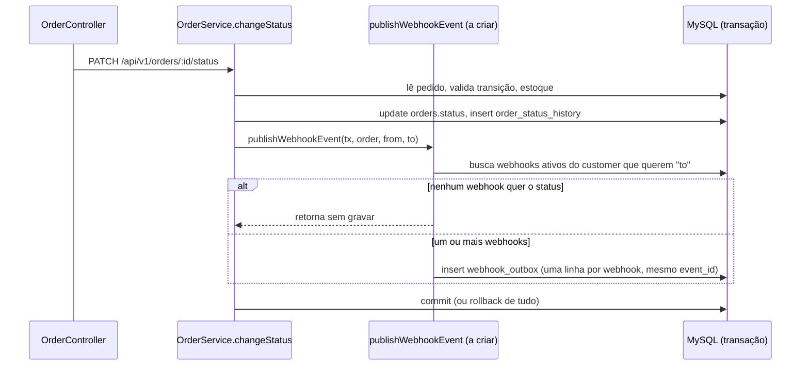
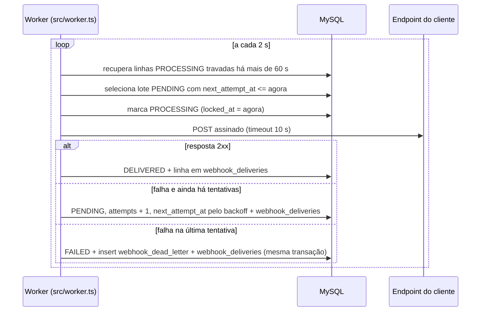

# FDD: Sistema de Webhooks de Notificação de Pedidos

| Campo | Valor |
| --- | --- |
| Status | Em revisão |
| Data | 14/10/2026 |
| Documentos relacionados | [PRD](PRD.md) · [RFC](RFC.md) · [ADRs](adrs/README.md) · [Tracker](TRACKER.md) |

**Como ler este documento.** `[hh:mm] Nome` indica a fala da reunião ([`TRANSCRICAO.md`](../TRANSCRICAO.md)) de onde veio o item. **(proposta)** marca uma escolha deste FDD sobre um ponto que a reunião não decidiu; ela vale até a revisão indicada no [RFC](RFC.md#questões-em-aberto). **(a criar)** marca arquivo, tabela ou rota que ainda não existe no código.

## 1. Contexto e motivação técnica

Os clientes B2B consultam GET /orders periodicamente para descobrir mudanças de status ([09:00] Marcos). A feature troca esse polling por uma notificação ativa, só de saída ([09:02] Marcos), em menos de 10 segundos ([09:02] Marcos).

Hoje a aplicação não tem nenhum mecanismo de evento ou fila. A mudança de status acontece em `OrderService.changeStatus` (`src/modules/orders/order.service.ts`), dentro de `prisma.$transaction`: o método lê o pedido, valida a transição em `src/modules/orders/order.status.ts`, debita ou repõe estoque, atualiza o status e grava `order_status_history`. Essa transação é o ponto de entrada da feature: o evento nasce nela ([09:40] Bruno) e sai por um processo separado. A justificativa de cada decisão está nos ADRs; este documento descreve como construir.

## 2. Objetivos técnicos

| # | Objetivo | Como verificar |
| --- | --- | --- |
| OT-1 | Toda mudança de status que algum webhook quer receber gera um evento na outbox; nenhuma mudança revertida gera evento ([09:06] Diego, [09:40] Bruno) | Teste de integração: transação com falha forçada não deixa linha na outbox |
| OT-2 | O worker pega um evento pendente em até 2 s após o commit ([09:10] Larissa) | Diferença entre `created_at` da outbox e `started_at` da primeira tentativa em `webhook_deliveries` |
| OT-3 | Cliente saudável recebe o evento em menos de 10 s após a mudança de status ([09:02] Marcos) | Métrica `webhook_delivery_latency_seconds` (seção 8) |
| OT-4 | Falha ou timeout de 10 s ([09:42] Diego) agenda as próximas tentativas com intervalos de 1 min, 5 min, 30 min, 2 h e 12 h ([09:17] Larissa) e, esgotadas, move para a DLQ ([09:18] Diego). Contagem de envios conforme a premissa provisória da seção 4.4 | Teste com relógio controlado |
| OT-5 | Todo envio leva assinatura HMAC-SHA256 verificável com a secret do endpoint ([09:22] Sofia) | Teste que recalcula a assinatura com a secret |
| OT-6 | Eventos de um mesmo pedido para um mesmo webhook chegam na ordem de criação, com um único worker ([09:13] Larissa) | Teste com dois eventos do mesmo pedido e falha no primeiro |
| OT-7 | Nenhum payload acima de 64 KB é enviado ([09:24] Larissa) | Teste com payload inflado |

## 3. Escopo e exclusões

**Incluso.**
- Módulo `src/modules/webhooks` (a criar) com cadastro, edição, remoção e listagem de webhooks por customer ([09:33] Bruno), rotação de secret ([09:21] Sofia) e histórico de entregas ([09:34] Marcos).
- Gravação do evento na transação de `changeStatus` ([09:40] Bruno).
- Worker em `src/worker.ts` (a criar), com retry, DLQ e reprocessamento manual por ADMIN ([09:18] Diego, [09:36] Larissa).

**Fora desta entrega** (detalhe no [PRD](PRD.md)):
- e-mail ao cliente quando o webhook falha ([09:37] Larissa);
- rate limiting de saída ([09:39] Larissa);
- dashboard visual ([09:40] Larissa);
- arquivamento da outbox ([09:08] Diego);
- vários workers em paralelo ([09:13] Diego);
- webhooks de entrada ([09:02] Marcos).

**Evento na criação do pedido (proposta).** `OrderService.create()` cria o pedido já em PENDING e grava a primeira linha de histórico, sem passar por `changeStatus`. Este FDD não gera evento na criação: a reunião tratou de mudança de status ([09:00] Marcos) e da integração em `changeStatus` ([09:40] Bruno). A lacuna está no [RFC](RFC.md#lacunas-identificadas-na-análise-não-discutidas-na-reunião).

## 4. Fluxos detalhados

### 4.1 Modelo de dados (proposta)

As tabelas seguem o padrão do `prisma/schema.prisma`: id `String @id @default(uuid()) @db.Char(36)` ([09:51] Larissa), `createdAt`, `updatedAt` e `@@map` em snake_case. Uma migração nova, só aditiva, entra em `prisma/migrations/`.

| Tabela (a criar) | Campos principais | Origem |
| --- | --- | --- |
| `webhook_endpoints` | `id`, `customer_id`, `url`, `secret`, `previous_secret`, `previous_secret_expires_at`, `statuses` (Json), `active`, `deleted_at`, `created_at`, `updated_at` | url, secret, customer_id e estado ativo ([09:21] Bruno); lista de status ([09:33] Marcos); rotação ([09:21] Sofia); `deleted_at` (proposta) |
| `webhook_outbox` | `id`, `event_id`, `webhook_id`, `order_id`, `event_type`, `payload` (Json), `status` (`PENDING`, `PROCESSING`, `FAILED`, `DELIVERED`), `attempts`, `next_attempt_at`, `locked_at`, `request_id` (VarChar 64), `created_at`, `updated_at` | Estados e índices em status e `created_at` ([09:08] Diego); payload pronto ([09:52] Larissa); índice em `(status, next_attempt_at)` (proposta) |
| `webhook_dead_letter` | `id`, `outbox_id`, `event_id`, `webhook_id`, `payload`, `reason`, `failed_at`, `replayed_at`, `replayed_by_id` | Payload, motivo e timestamp ([09:18] Diego) |
| `webhook_deliveries` | `id`, `outbox_id`, `webhook_id`, `event_id`, `attempt`, `success`, `response_status`, `response_body`, `started_at`, `duration_ms`, `error_code`, `created_at` | Sucesso ou falha, payload, response e tempo ([09:34] Marcos) |

**Decisões deste modelo (proposta).**
- **Uma linha de outbox por par (evento, webhook)**, todas com o mesmo `event_id`. Assim cada endpoint tem retry, DLQ e reprocessamento próprios. O ponto está como lacuna no [RFC](RFC.md#lacunas-identificadas-na-análise-não-discutidas-na-reunião).
- **`statuses` é uma coluna Json** com a lista de `OrderStatus`. O Prisma não tem lista escalar no MySQL. O filtro da seção 4.2 roda no código, sobre os poucos webhooks de um customer.
- **`FAILED` é o estado terminal da outbox**, gravado na mesma transação que cria a linha na DLQ. Enquanto espera retry, a linha fica em `PENDING` com `next_attempt_at` no futuro. Isso resolve a convivência entre o estado "falhou" ([09:08] Diego) e a DLQ em tabela própria ([09:18] Diego).
- **Remoção é lógica** (`deleted_at`). Outbox, histórico e DLQ continuam apontando para um webhook que existe, e o histórico continua consultável.
- **FK de `webhook_endpoints.customer_id` para `customers`** com o comportamento padrão de restrição, igual ao de `orders.customer_id`. Um customer com webhook não pode ser removido, como já acontece com quem tem pedido.
- **O payload fica só na outbox e na DLQ.** O histórico de entregas aponta para a outbox pelo `outbox_id`.
- **`response_body` guarda os primeiros 4 KB da resposta**, para o histórico não crescer sem controle.
- **Armazenamento da secret** depende da revisão de segurança ([RFC](RFC.md#lacunas-identificadas-na-análise-não-discutidas-na-reunião)). Requisitos mínimos: o worker precisa conseguir ler a secret para assinar; ela não volta em resposta fora da criação e da rotação (proposta); e nunca aparece em log (seção 8).

### 4.2 Criação do evento na outbox



1. `changeStatus` chama `publishWebhookEvent(tx, order, fromStatus, toStatus)` ([09:41] Bruno) depois de gravar o histórico e antes de reler o pedido. A função recebe o client da transação, então grava no mesmo commit ([09:41] Diego).
2. A função busca os webhooks do `order.customerId` com `deleted_at` nulo e filtra, no código, os que têm `toStatus` na lista `statuses`. Se não sobrar nenhum, não grava nada ([09:34] Bruno). Webhook pausado (`active = false`) também recebe o evento na outbox; quem segura o envio é o worker (seção 4.3).
3. Monta o payload uma vez ([09:52] Larissa), com `to_status = toStatus`. O objeto `order` lido no início de `changeStatus` é anterior ao update, então o campo de status dele não serve.
4. Gera um `event_id` UUID ([09:25] Diego) com a biblioteca `uuid`, que já está no `package.json`.
5. Confere o tamanho do payload serializado. Com os campos da seção 5.2 e sem `items`, ele fica em poucas centenas de bytes, então o limite de 64 KB ([09:24] Larissa) funciona como guarda. Se passar, a linha entra na outbox já como `FAILED` e, na mesma transação, entra na DLQ com `reason = WEBHOOK_PAYLOAD_TOO_LARGE` **(proposta)**. Nada é enviado nem truncado, como Larissa pediu ([09:24] Larissa), e a mudança de status não é desfeita.
6. Insere uma linha em `webhook_outbox` por webhook, com `status = PENDING`, `attempts = 0`, `next_attempt_at = now()` e `request_id` (seção 8).
7. Devolve a lista de `event_id` e `webhook_id` gravados. `changeStatus` só loga `webhook_event_enqueued` depois que `prisma.$transaction` resolve, para não registrar evento de uma transação que deu rollback.
8. Qualquer exceção na função propaga. `prisma.$transaction` faz rollback de tudo, inclusive da mudança de status ([09:40] Bruno), e a API responde 500 pelo `errorMiddleware`.

**`request_id` (proposta).** `changeStatus` ganha um quarto parâmetro opcional, `requestId`. `OrderController.changeStatus` passa `req.id`, gerado por `src/middlewares/request-logger.middleware.ts`. O middleware aceita o `X-Request-Id` enviado pelo cliente sem limite de tamanho, então o valor é cortado em 64 caracteres antes de gravar. Assim um header longo não derruba a transação.

### 4.3 Processamento pelo worker



1. **Ciclo.** A cada 2 s ([09:09] Diego), o worker busca até 10 linhas **(proposta para "batch pequeno", [09:08] Diego)** com `status = PENDING` e `next_attempt_at <= now()`, ordenadas por `created_at` ([09:12] Diego).
2. **Ordem por pedido (proposta).** Uma linha só é elegível se não houver outra linha mais antiga do mesmo `(webhook_id, order_id)` em `PENDING` ou `PROCESSING`. A condição entra na própria consulta, com `NOT EXISTS` via `$queryRaw`, antes do `LIMIT`, para o lote não vir cheio de linhas bloqueadas. Sem essa regra, um evento em backoff seria ultrapassado pelo seguinte do mesmo pedido, e a ordem de [09:13] Larissa se perderia. Limite conhecido: um evento reprocessado da DLQ chega depois dos eventos seguintes do mesmo pedido.
3. **Webhook pausado ou removido (proposta).** Linha de webhook com `active = false` fica em `PENDING` e não é enviada até o webhook ser reativado; é isso que faz a pausa funcionar. Linha de webhook com `deleted_at` preenchido vai para `FAILED` com `reason = WEBHOOK_DELETED`, sem DLQ, e não é enviada.
4. **Claim, linha a linha.** `UPDATE ... SET status = 'PROCESSING', locked_at = now() WHERE id = ? AND status = 'PENDING'`, imediatamente antes do envio daquela linha. Se nenhuma linha for afetada, outro processo já pegou, e o worker pula. O desenho continua sendo de um único worker ([09:12] Diego); o claim só evita envio duplicado se alguém subir dois por engano, e não garante ordem nesse caso.
5. **Envio em paralelo dentro do lote (proposta).** As linhas elegíveis do lote são enviadas em paralelo (`Promise.allSettled`). Com envio sequencial, dez clientes lentos somariam até 100 s e estourariam a meta de 10 s para os outros. A regra do passo 2 garante que duas linhas do mesmo pedido e do mesmo webhook nunca estão no mesmo lote.
6. **Requisição.** POST para a `url` do webhook, com o corpo e os headers da seção 5.2, usando `fetch` nativo com `AbortSignal.timeout(10_000)` ([09:42] Diego) e `redirect: 'manual'` **(proposta)**. Uma resposta 3xx conta como falha; seguir o redirect permitiria trocar o `https` cadastrado por `http` ([09:23] Sofia). O Node `>=20` declarado em `package.json` já tem essas APIs; nenhuma dependência nova.
7. **Resultado.** Toda tentativa grava uma linha em `webhook_deliveries` com `started_at` e `duration_ms`. Uma resposta 2xx é sucesso; qualquer outra resposta, timeout ou erro de rede é falha **(proposta: a reunião não distinguiu 4xx de 5xx)**.
8. **Linhas travadas (proposta).** No início de cada ciclo, linhas em `PROCESSING` com `locked_at` há mais de 60 s (timeout de 10 s mais margem) contam como tentativa falha: `attempts + 1`, linha em `webhook_deliveries` com `error_code = WEBHOOK_DELIVERY_INTERRUPTED` e reagendamento pela seção 4.4, ou DLQ se era a última. Um evento que derruba o worker toda vez chega à DLQ em vez de girar para sempre. O cliente pode receber repetido, o que o at-least-once já prevê ([09:24] Diego).

### 4.4 Retry

| Envio | Quando | Origem |
| --- | --- | --- |
| 1 (original) | No primeiro ciclo após o commit | [09:09] Diego |
| 2 | 1 min após a falha do envio 1 | [09:17] Diego |
| 3 | 5 min após a falha do envio 2 | [09:17] Diego |
| 4 | 30 min após a falha do envio 3 | [09:17] Diego |
| 5 | 2 h após a falha do envio 4 | [09:17] Diego |
| 6 | 12 h após a falha do envio 5 | [09:17] Diego |

**Premissa provisória.** A tabela segue a leitura de 1 envio inicial mais 5 retentativas. A contagem está em aberto (questão 1 do [RFC](RFC.md#levantadas-na-reunião-e-adiadas-ou-não-decididas)). Se ficar em 5 envios no total, sai a última linha.

`attempts` conta envios feitos. `next_attempt_at = horário da falha + intervalo[attempts]`. Os intervalos ficam como constantes no módulo. A reunião fixou os valores e não pediu que fossem configuráveis.

### 4.5 DLQ e reprocessamento

1. **Ida para a DLQ.** Quando a última tentativa falha, numa única transação, a linha da outbox vai para `FAILED` e entra uma linha em `webhook_dead_letter` com `payload`, `reason` (código do último erro, seção 6) e `failed_at` ([09:18] Diego).
2. **Pedido de reprocessamento.** Um ADMIN chama `POST /api/v1/admin/webhooks/dead-letter/:id/replay` ([09:35] Diego). O id vem do log `webhook_moved_to_dead_letter` ou de consulta ao banco: a reunião não pediu endpoint de listagem da DLQ.
3. **Transação do reprocessamento (proposta).** Só procede se a linha da DLQ tem `replayed_at` nulo e a linha da outbox ainda está `FAILED`. A verificação é um update condicional; se não afetar nenhuma linha, a resposta é 409 `WEBHOOK_ALREADY_REPLAYED`.
   - A linha da outbox volta para `PENDING`, com `attempts = 0` e `next_attempt_at = now()`. O evento volta à outbox como pendente ([09:18] Diego).
   - O `event_id` original é mantido: o cliente que já processou o evento descarta a repetição pelo `X-Event-Id` ([09:25] Diego).
   - `replayed_at` e `replayed_by_id` são preenchidos na linha da DLQ.
   - Se o reenvio esgotar as tentativas de novo, nasce uma linha nova na DLQ. Cada linha da DLQ é um esgotamento, e a anterior fica como histórico.
4. **Casos que não reprocessam.** Webhook removido responde 404 `WEBHOOK_NOT_FOUND`. Motivo `WEBHOOK_PAYLOAD_TOO_LARGE` responde 422 com o mesmo código, porque o payload continuaria grande demais.
5. **Auditoria.** Um log `webhook_replay_requested` registra quem pediu ([09:36] Sofia).

### 4.6 Rotação de secret

1. O cliente chama `POST /api/v1/webhooks/:id/secret/rotate` **(proposta de rota; a reunião pediu o endpoint sem definir o caminho, [09:21] Sofia)**.
2. A secret atual vai para `previous_secret`, com `previous_secret_expires_at = now() + 24 h` ([09:21] Sofia). Uma nova secret é gerada e devolvida uma única vez.
3. Durante a carência, o worker assina com as duas secrets e envia as duas assinaturas no mesmo header, separadas por vírgula **(proposta, pendente da revisão de Sofia; lacuna no [RFC](RFC.md#lacunas-identificadas-na-análise-não-discutidas-na-reunião))**. O cliente separa os valores pela vírgula e aceita o envio se qualquer um bater com a secret que ele tem. Isso precisa estar na documentação do portal ([09:26] Marcos), porque quem compara o header inteiro falha durante a carência. Passadas as 24 h, `previous_secret` deixa de ser usada.
4. Só existe uma secret anterior. Uma segunda rotação dentro das 24 h descarta a mais antiga na hora **(proposta)**.
5. **Geração (proposta).** 32 bytes aleatórios de `crypto.randomBytes`, em hex. Sofia vai revisar a geração ([09:46] Sofia).

## 5. Contratos públicos

Todas as rotas ficam sob `/api/v1`, como em `src/app.ts`, e exigem `Authorization: Bearer <jwt>` (`authenticate` de `src/middlewares/auth.middleware.ts`). Erros seguem o formato do `errorMiddleware`: `{ "error": { "code", "message", "details?" } }`.

**Onde vai o `customerId` (proposta).** No body, na criação, e na query, na listagem. É o mesmo padrão de `createOrderSchema` e `listOrdersQuerySchema` em `src/modules/orders/order.schemas.ts`. A reunião deixou "no body ou no path" ([09:32] Larissa).

**Permissão.** O CRUD de configuração aceita qualquer role autenticada, por enquanto ([09:37] Sofia). O reprocessamento exige `requireRole('ADMIN')` ([09:36] Larissa). Rotação de secret e histórico de entregas não foram citados nessa fala. Este FDD aplica a eles a mesma regra do CRUD **(proposta)**. O risco é maior aqui: quem rotaciona recebe a secret nova e passa a conseguir assinar envios em nome da plataforma (seção 12).

### 5.1 Endpoints da API

**1. Cadastrar webhook: `POST /api/v1/webhooks`** ([09:31] Marcos)

```json
{
  "customerId": "6f1c2a7e-3b4d-4e5f-8a9b-0c1d2e3f4a5b",
  "url": "https://integracao.atlas.example/webhooks/pedidos",
  "statuses": ["SHIPPED", "DELIVERED"]
}
```

Resposta `201 Created`. A `secret` é devolvida na criação ([09:31] Marcos); fora daqui, ela só volta na rotação **(proposta)**.

```json
{
  "id": "0b7d9c4e-1a2b-4c3d-9e8f-7a6b5c4d3e2f",
  "customerId": "6f1c2a7e-3b4d-4e5f-8a9b-0c1d2e3f4a5b",
  "url": "https://integracao.atlas.example/webhooks/pedidos",
  "statuses": ["SHIPPED", "DELIVERED"],
  "active": true,
  "secret": "3f9a5c0e…",
  "createdAt": "2026-10-14T12:00:00.000Z",
  "updatedAt": "2026-10-14T12:00:00.000Z"
}
```

Status:
- `400 VALIDATION_ERROR`: corpo inválido, por exemplo um status fora de `OrderStatus`;
- `400 WEBHOOK_INVALID_URL`: URL sem `https` ([09:23] Sofia);
- `404 WEBHOOK_CUSTOMER_NOT_FOUND`;
- `401 UNAUTHORIZED`.

**2. Listar webhooks de um customer: `GET /api/v1/webhooks?customerId=<uuid>&page=1&pageSize=20`** ([09:33] Bruno)

Resposta `200 OK`, no formato `paginated()` de `src/shared/http/response.ts`, sem `secret`:

```json
{
  "data": [
    {
      "id": "0b7d9c4e-1a2b-4c3d-9e8f-7a6b5c4d3e2f",
      "customerId": "6f1c2a7e-3b4d-4e5f-8a9b-0c1d2e3f4a5b",
      "url": "https://integracao.atlas.example/webhooks/pedidos",
      "statuses": ["SHIPPED", "DELIVERED"],
      "active": true,
      "createdAt": "2026-10-14T12:00:00.000Z",
      "updatedAt": "2026-10-14T12:00:00.000Z"
    }
  ],
  "pagination": { "page": 1, "pageSize": 20, "total": 1, "totalPages": 1 }
}
```

Status:
- `400 VALIDATION_ERROR`: `customerId` ausente ou inválido;
- `401 UNAUTHORIZED`.

**3. Editar webhook: `PATCH /api/v1/webhooks/:id`** ([09:33] Bruno)

```json
{ "statuses": ["PROCESSING", "SHIPPED", "DELIVERED"], "active": true }
```

Resposta `200 OK`, sem `secret`:

```json
{
  "id": "0b7d9c4e-1a2b-4c3d-9e8f-7a6b5c4d3e2f",
  "customerId": "6f1c2a7e-3b4d-4e5f-8a9b-0c1d2e3f4a5b",
  "url": "https://integracao.atlas.example/webhooks/pedidos",
  "statuses": ["PROCESSING", "SHIPPED", "DELIVERED"],
  "active": true,
  "createdAt": "2026-10-14T12:00:00.000Z",
  "updatedAt": "2026-10-14T15:30:00.000Z"
}
```

Status:
- `400 VALIDATION_ERROR`;
- `400 WEBHOOK_INVALID_URL`;
- `404 WEBHOOK_NOT_FOUND`.

A mudança de `statuses` vale para eventos novos: o filtro roda na inserção ([09:34] Bruno), e o que já está na outbox segue.

**4. Remover webhook: `DELETE /api/v1/webhooks/:id`** ([09:33] Bruno)

Resposta `204 No Content`. Status: `404 WEBHOOK_NOT_FOUND`.

**Semântica (proposta).** A remoção é lógica: preenche `deleted_at`. O webhook deixa de aparecer na listagem e de receber eventos novos. O worker descarta as linhas pendentes dele, inclusive uma que estava em envio e volte para `PENDING` (seção 4.3). O histórico continua disponível em `GET /webhooks/:id/deliveries`.

Para só pausar, o caminho é `PATCH` com `active: false`. Os eventos continuam entrando na outbox e são enviados quando o webhook volta a `active: true`.

**5. Rotacionar secret: `POST /api/v1/webhooks/:id/secret/rotate`** (proposta de rota, [09:21] Sofia)

Sem corpo. Resposta `200 OK`:

```json
{
  "id": "0b7d9c4e-1a2b-4c3d-9e8f-7a6b5c4d3e2f",
  "secret": "8c1e7b2d…",
  "previousSecretExpiresAt": "2026-10-15T12:00:00.000Z"
}
```

Status: `404 WEBHOOK_NOT_FOUND`.

**6. Histórico de entregas: `GET /api/v1/webhooks/:id/deliveries`** ([09:34] Marcos)

Resposta `200 OK`. São as 100 tentativas mais recentes, da mais nova para a mais antiga, sem paginação: a reunião pediu "os últimos 100" ([09:34] Marcos). O `payload` vem da linha da outbox.

```json
{
  "data": [
    {
      "id": "5e4d3c2b-1a0f-4e9d-8c7b-6a5f4e3d2c1b",
      "eventId": "9a8b7c6d-5e4f-4a3b-2c1d-0e9f8a7b6c5d",
      "attempt": 2,
      "success": false,
      "responseStatus": 503,
      "responseBody": "Service Unavailable",
      "durationMs": 184,
      "errorCode": "WEBHOOK_DELIVERY_HTTP_ERROR",
      "payload": { "event_id": "9a8b7c6d-5e4f-4a3b-2c1d-0e9f8a7b6c5d", "event_type": "order.status_changed" },
      "createdAt": "2026-10-14T12:01:02.000Z"
    }
  ]
}
```

Status: `404 WEBHOOK_NOT_FOUND`.

**7. Reprocessar evento da DLQ: `POST /api/v1/admin/webhooks/dead-letter/:id/replay`** ([09:35] Diego)

Sem corpo. Exige role ADMIN ([09:36] Larissa). Resposta `202 Accepted`. O envio acontece no próximo ciclo do worker.

```json
{
  "deadLetterId": "3c2b1a0f-9e8d-4c7b-6a5f-4e3d2c1b0a9f",
  "outboxId": "7f6e5d4c-3b2a-4190-8f7e-6d5c4b3a2f1e",
  "eventId": "9a8b7c6d-5e4f-4a3b-2c1d-0e9f8a7b6c5d",
  "status": "PENDING"
}
```

Status:
- `403 FORBIDDEN`: role diferente de ADMIN;
- `404 WEBHOOK_DEAD_LETTER_NOT_FOUND`;
- `404 WEBHOOK_NOT_FOUND`: o webhook foi removido;
- `409 WEBHOOK_ALREADY_REPLAYED`;
- `422 WEBHOOK_PAYLOAD_TOO_LARGE`.

### 5.2 Envio para o cliente

O envio é `POST <url do webhook>`, com corpo JSON.

**Payload.** Os campos são os que Diego listou ([09:43] Diego), em snake_case como ele os nomeou. Isso é diferente do camelCase da API interna, porque este é o contrato externo.

```json
{
  "event_id": "9a8b7c6d-5e4f-4a3b-2c1d-0e9f8a7b6c5d",
  "event_type": "order.status_changed",
  "timestamp": "2026-10-14T12:00:00.412Z",
  "order_id": "1d2c3b4a-5f6e-4d7c-8b9a-0f1e2d3c4b5a",
  "order_number": "ORD-000123",
  "from_status": "PROCESSING",
  "to_status": "SHIPPED",
  "customer_id": "6f1c2a7e-3b4d-4e5f-8a9b-0c1d2e3f4a5b",
  "total_cents": 125990
}
```

- `timestamp` é o momento da mudança de status, gravado no snapshot **(proposta)**. Diego pediu "timestamp ISO 8601" no payload sem dizer de quê ([09:43] Diego). O momento do envio vai no header `X-Timestamp` ([09:44] Diego).
- A reunião disse "campos básicos da order tipo total_cents" ([09:43] Diego) e não fechou a lista. Este FDD envia só os campos nomeados.
- Não há `items`. Para mais detalhes, o cliente consulta GET /orders/:id ([09:43] Diego).

**Headers.**

| Header | Valor | Origem |
| --- | --- | --- |
| `Content-Type` | `application/json` | [09:44] Diego |
| `X-Event-Id` | `event_id` do evento, igual em todas as tentativas e no reprocessamento | [09:44] Diego |
| `X-Webhook-Id` | id do cadastro de webhook que recebeu o envio | [09:44] Sofia |
| `X-Timestamp` | momento do envio, ISO 8601 | [09:44] Diego |
| `X-Signature` | HMAC-SHA256 do corpo exato enviado ([09:22] Sofia). Formato `sha256=<hex>`; durante a carência de rotação, `sha256=<nova>,sha256=<antiga>` **(formato proposto)** | [09:20] Sofia, [09:44] Diego |

**Resposta esperada do cliente.** Uma resposta 2xx **(proposta)** em até 10 s ([09:42] Diego). O corpo da resposta é ignorado, exceto para o histórico.

## 6. Matriz de erros

Os erros do módulo seguem `AppError` (`src/shared/errors/app-error.ts`) com prefixo `WEBHOOK_` ([09:29] Larissa).

**Classes usadas.** As classes de `src/shared/errors/http-errors.ts` são reaproveitadas onde já aceitam código próprio: `BadRequestError`, `ConflictError` e `UnprocessableEntityError`. `NotFoundError` tem código fixo (`NOT_FOUND`), então os erros 404 do módulo estendem `AppError` direto, em `src/modules/webhooks/webhook.errors.ts` (a criar).

Na coluna Origem, a fala citada é a regra; o nome do código, quando não foi dito na reunião, é proposta deste FDD.

**Erros da API**

| Código | HTTP | Classe | Quando | Origem |
| --- | --- | --- | --- | --- |
| `WEBHOOK_NOT_FOUND` | 404 | nova, estende `AppError` | Webhook inexistente ou removido no PATCH, DELETE, rotação ou reprocessamento | código citado por [09:28] Bruno |
| `WEBHOOK_INVALID_URL` | 400 | `BadRequestError` | URL sem `https` | regra de [09:23] Sofia; código citado por [09:28] Bruno |
| `WEBHOOK_CUSTOMER_NOT_FOUND` | 404 | nova, estende `AppError` | `customerId` inexistente no cadastro | proposta |
| `WEBHOOK_DEAD_LETTER_NOT_FOUND` | 404 | nova, estende `AppError` | Item da DLQ inexistente | proposta |
| `WEBHOOK_ALREADY_REPLAYED` | 409 | `ConflictError` | Item da DLQ já reprocessado, ou linha da outbox que não está mais `FAILED` | proposta |
| `WEBHOOK_PAYLOAD_TOO_LARGE` | 422 | `UnprocessableEntityError` | Reprocessamento de item que foi para a DLQ por tamanho | regra de [09:24] Larissa; nome proposto |
| `VALIDATION_ERROR` | 400 | `ValidationError` (existente) | Corpo, query ou params fora do schema Zod | [09:30] Larissa |
| `UNAUTHORIZED` / `FORBIDDEN` | 401 / 403 | existentes | Sem token, ou role diferente de ADMIN no reprocessamento | [09:36] Larissa |

**Motivos gravados no histórico e na DLQ (não são resposta HTTP)**

| Código | Quando | Origem |
| --- | --- | --- |
| `WEBHOOK_DELIVERY_TIMEOUT` | O cliente não respondeu em 10 s | regra de [09:42] Diego; nome proposto |
| `WEBHOOK_DELIVERY_HTTP_ERROR` | Resposta fora de 2xx, inclusive redirect | proposta |
| `WEBHOOK_DELIVERY_NETWORK_ERROR` | Falha de DNS, conexão ou TLS | proposta |
| `WEBHOOK_DELIVERY_INTERRUPTED` | O worker caiu durante o envio (linha presa em `PROCESSING`) | proposta |
| `WEBHOOK_PAYLOAD_TOO_LARGE` | Payload acima de 64 KB; vai direto para a DLQ | regra de [09:24] Larissa; nome proposto |
| `WEBHOOK_DELETED` | Linha de um webhook removido; vai para `FAILED`, sem DLQ | proposta |

**Onde nasce `WEBHOOK_INVALID_URL` (proposta).** Sofia tratou o HTTPS como validação de schema Zod ([09:23] Sofia). O `validate.middleware.ts` converte todo erro Zod em `VALIDATION_ERROR`, então uma regra só no Zod nunca sairia com o código do módulo. A proposta divide o trabalho:
- o schema valida o formato de URL;
- o service rejeita o que não for `https` com `WEBHOOK_INVALID_URL`.

A alternativa seria manter tudo no Zod e aceitar o código genérico.

**`WEBHOOK_SECRET_REQUIRED`** ([09:28] Bruno) não entra: a secret é gerada pela plataforma ([ADR-004](adrs/ADR-004-hmac-sha256-com-secret-por-endpoint.md)).

**Falha ao gravar na outbox.** A exceção derruba a transação de `changeStatus`. O `errorMiddleware` responde `500 INTERNAL_SERVER_ERROR` e o status não muda ([09:40] Bruno).

## 7. Estratégias de resiliência

| Situação | Comportamento | Origem |
| --- | --- | --- |
| Cliente lento | Timeout de 10 s; conta como falha e entra no retry | [09:42] Diego |
| Cliente fora do ar | Retry com intervalos de 1 min, 5 min, 30 min, 2 h e 12 h (contagem de envios na seção 4.4); depois, DLQ | [09:17] Larissa, [09:18] Diego |
| Cliente responde com redirect | Conta como falha; o worker não segue o redirect, para não trocar `https` por `http` | proposta, [09:23] Sofia |
| Falha na gravação do evento | Rollback da mudança de status; status e evento nunca divergem | [09:40] Bruno |
| API reinicia | O worker é outro processo e segue entregando | [09:11] Diego |
| Worker cai no meio de um envio | Linha presa em `PROCESSING` há mais de 60 s conta como tentativa falha (`WEBHOOK_DELIVERY_INTERRUPTED`) e segue o backoff; o cliente pode receber repetido e deduplica pelo `X-Event-Id` | proposta, [09:24] Diego |
| Banco indisponível | O ciclo falha, loga `webhook_worker_cycle_failed` e tenta no próximo ciclo, sem derrubar o processo | proposta |
| Dois workers por engano | O claim condicional (seção 4.3) evita que a mesma linha seja enviada duas vezes; a ordem por pedido não é garantida nesse caso | proposta |
| Payload acima de 64 KB | Não envia; grava na DLQ com `WEBHOOK_PAYLOAD_TOO_LARGE` | [09:24] Larissa |
| Fallback por outro canal | Não há nesta fase: o aviso por e-mail ficou para a próxima | [09:37] Larissa |

**Encerramento do worker (proposta).** Ao receber SIGINT ou SIGTERM, o worker para de buscar novas linhas, espera os envios em andamento (no máximo 10 s, o timeout) e só então chama `$disconnect()` e encerra. O `src/server.ts` chama `process.exit(0)` logo depois do `$disconnect`; esse padrão não serve para o worker, porque cortaria um envio no meio.

## 8. Observabilidade

A reunião não discutiu observabilidade. Esta seção é proposta deste FDD, apoiada no que o projeto já tem: o logger Pino (`src/shared/logger/index.ts`) e o `X-Request-Id` gerado em `src/middlewares/request-logger.middleware.ts`.

### Logs

Logs estruturados em JSON com o logger existente:

| Evento de log | Campos | Onde |
| --- | --- | --- |
| `webhook_event_enqueued` | `eventId`, `webhookId`, `orderId`, `fromStatus`, `toStatus`, `requestId` | API, após o commit |
| `webhook_delivery_succeeded` | `eventId`, `webhookId`, `attempt`, `responseStatus`, `durationMs`, `requestId` | Worker |
| `webhook_delivery_failed` | `eventId`, `webhookId`, `attempt`, `errorCode`, `responseStatus`, `nextAttemptAt` | Worker |
| `webhook_moved_to_dead_letter` | `eventId`, `webhookId`, `deadLetterId`, `reason` | Worker |
| `webhook_replay_requested` | `deadLetterId`, `eventId`, `userId` (auditoria de [09:36] Sofia) | API |
| `webhook_secret_rotated` | `webhookId`, `userId` | API |
| `webhook_worker_cycle_failed` | `err` | Worker |

**Proteção de dados.**
- `secret`, `previousSecret` e o valor de `X-Signature` nunca entram em log. Os caminhos `secret`, `*.secret`, `previousSecret` e `*.previousSecret` entram no `redact` do logger; o curinga `*.` do Pino só pega um nível, então o campo no topo do objeto precisa do caminho próprio.
- O payload não é logado, só ids.

**Nome do serviço nos logs.** O logger fixa `service: 'order-management-api'`. O worker precisa de outro nome, `order-management-webhook-worker`, para separar os logs.

### Métricas

| Métrica | Tipo | Para quê |
| --- | --- | --- |
| `webhook_outbox_pending` | gauge | Backlog de envios; cresce quando o worker não dá conta |
| `webhook_delivery_latency_seconds` | histograma | Do `created_at` da outbox até o fim do envio com resposta 2xx; acompanha a meta de 10 s (OT-3). Envios depois de reprocessamento da DLQ ficam fora, porque a contagem recomeça |
| `webhook_deliveries_total{result}` | contador | `result` = `success`, `http_error`, `timeout`, `network_error` |
| `webhook_dead_letter_total` | contador | Eventos que esgotaram as tentativas |
| `webhook_sends_per_webhook_per_minute` | gauge por webhook | Dado para decidir o rate limiting ([09:39] Larissa) |

**Coleta (proposta).** O projeto não tem biblioteca de métricas, e este FDD não cria dependência sem aprovação. As medidas vêm de duas fontes que o desenho já tem:
- os logs de cada envio, que carregam `durationMs`, resultado e tentativa;
- um log `webhook_worker_stats`, emitido pelo worker a cada 60 s, com os valores de `webhook_outbox_pending`, `webhook_dead_letter_total` e envios por webhook no último minuto, calculados por SQL sobre `webhook_outbox`, `webhook_deliveries` e `webhook_dead_letter`.

O p95 de latência do critério de aceite sai de consulta direta em `webhook_deliveries`. Expor em Prometheus fica para quando o time escolher a ferramenta.


### Tracing

O projeto não tem tracing distribuído. A proposta é rastrear por correlação de ids, ponta a ponta:

1. O `X-Request-Id` da chamada a `PATCH /orders/:id/status` vai para a coluna `request_id` da outbox (seção 4.2).
2. O `event_id` liga essa linha a cada tentativa em `webhook_deliveries` e à DLQ.
3. Os logs da API e do worker carregam `requestId` e `eventId`.

Assim, uma busca por `requestId` mostra a mudança de status, o evento e cada envio. Spans OpenTelemetry (`webhook.publish` na API e `webhook.deliver` no worker) ficam como evolução, se o time adotar a ferramenta.

## 9. Integração com o sistema existente

**Arquivos existentes**

| Arquivo | Hoje | Mudança |
| --- | --- | --- |
| `src/modules/orders/order.service.ts` | `changeStatus(id, input, userId)` roda em `prisma.$transaction`, atualiza o status e grava o histórico | Chamar `publishWebhookEvent(tx, order, from, to)` depois do insert em `orderStatusHistory`, dentro da mesma transação ([09:41] Bruno). O snapshot usa `to`, não `order.status`, que é anterior ao update. O método ganha o parâmetro opcional `requestId` e passa a logar `webhook_event_enqueued` depois que a transação resolve (seção 4.2). O construtor não muda. |
| `src/modules/orders/order.controller.ts` | `changeStatus` chama o service com `req.params.id`, `req.body` e `req.user.id` | Passar também `req.id` como `requestId`. |
| `src/modules/orders/order.status.ts` | Define as transições de `OrderStatus` | Sem mudança. O schema de `statuses` usa `z.nativeEnum(OrderStatus)`, como faz `updateOrderStatusSchema`. |
| `prisma/schema.prisma` | Modelos com id `uuid()` e `@db.Char(36)`; `orders.customer_id` com FK restritiva | Quatro modelos novos (seção 4.1) e a relação `Customer` → `WebhookEndpoint`, com a mesma FK restritiva. |
| `prisma/migrations/` | Uma migração inicial | Uma migração nova, só aditiva. |
| `src/app.ts` | `buildControllers` instancia repository, service e controller por módulo | Instanciar `WebhookRepository`, `WebhookService` e `WebhookController` (a criar) e devolvê-los em `webhooks`. |
| `src/routes/index.ts` | `Controllers` e `buildApiRouter` registram cada módulo | Adicionar `webhooks` ao tipo `Controllers` e registrar `router.use('/webhooks', …)` e `router.use('/admin', …)` com o roteador administrativo do módulo. |
| `src/middlewares/auth.middleware.ts` | `authenticate` e `requireRole` | Sem mudança. As rotas usam `authenticate`; o reprocessamento usa `requireRole('ADMIN')` ([09:36] Larissa). |
| `src/middlewares/validate.middleware.ts` | Valida com Zod e devolve `VALIDATION_ERROR` | Sem mudança. Os schemas do módulo usam o mesmo `validate()`. |
| `src/middlewares/error.middleware.ts` | Trata `AppError`, Zod e Prisma | Sem mudança: as classes novas estendem `AppError` ([09:29] Bruno). Ele não roda no worker; lá o erro é tratado no próprio ciclo (seção 7). |
| `src/shared/errors/app-error.ts`, `src/shared/errors/http-errors.ts` | Base `AppError` e classes com código fixo | Sem mudança nos arquivos. As classes novas ficam no módulo (seção 6). |
| `src/shared/logger/index.ts` | Pino com `redact` de senha e tokens e `service` fixo | Incluir `secret`, `*.secret`, `previousSecret` e `*.previousSecret` no `redact`. Permitir que `createLogger` receba o nome do serviço, para o worker. |
| `src/shared/http/response.ts` | `paginated()` | Reusado na listagem de webhooks. |
| `src/middlewares/request-logger.middleware.ts` | Gera `req.id` e o header `X-Request-Id` | Sem mudança. O `req.id` vai para a outbox (seção 8). |
| `src/config/database.ts` | Exporta `createPrismaClient()` e a instância `prisma` | Sem mudança. O worker chama `createPrismaClient()` no próprio processo ([09:30] Bruno). |
| `src/config/env.ts` | Valida `DATABASE_URL`, `JWT_SECRET` e outras variáveis, e encerra o processo se faltar alguma | Sem mudança nesta fase. O worker carrega o mesmo `.env`, então `JWT_SECRET` precisa existir também no ambiente dele, mesmo sem uso. |
| `src/server.ts` | Entry-point da API | Modelo para `src/worker.ts` (a criar), exceto o encerramento (seção 7). |
| `package.json` | Scripts `dev` e `start`; dependência `uuid`; Node `>=20` | Novos scripts `worker` (`tsx --env-file=.env src/worker.ts`) e `worker:start` (`node --env-file=.env dist/worker.js`) ([09:11] Larissa). Nenhuma dependência nova. |
| `src/modules/customers/customer.repository.ts` | `findById` | Usado para validar o `customerId` no cadastro. |
| `tests/helpers/factories.ts`, `tests/setup.ts` | Fábricas e limpeza de tabelas por teste | Fábrica `createTestWebhook`. As quatro tabelas novas entram no `beforeEach` de limpeza, antes de `order`. |

**Arquivos novos em `src/modules/webhooks/` (a criar)**

| Arquivo | Papel |
| --- | --- |
| `webhook.routes.ts`, `webhook.admin.routes.ts` | Rotas da seção 5.1 |
| `webhook.controller.ts` | Controllers no padrão de `OrderController` |
| `webhook.service.ts` | Regras do CRUD, rotação e reprocessamento |
| `webhook.repository.ts` | Acesso às quatro tabelas |
| `webhook.schemas.ts` | Schemas Zod |
| `webhook.errors.ts` | Classes de erro da seção 6 |
| `webhook.publisher.ts` | `publishWebhookEvent` |
| `webhook.signer.ts` | Assinatura HMAC |
| `webhook.processor.ts` | Ciclo do worker. A reunião deixou o nome entre `webhook.worker.ts` e `webhook.processor.ts` ([09:28] Bruno); a proposta é `processor`, porque a entry-point já se chama `worker.ts`. |

## 10. Dependências e compatibilidade

- **Runtime.** Node `>=20` (`package.json`), para `fetch` e `AbortSignal.timeout`. MySQL 8 (`docker-compose.yml`). Prisma 5.22.0 e `uuid` 11.0.3, já no projeto. Nenhuma dependência nova.
- **Banco.** A migração é só aditiva: quatro tabelas novas, nenhuma coluna alterada em tabela existente. Pode ir para produção antes do código. Efeito colateral: um customer com webhook não pode mais ser removido, como já acontece com quem tem pedido. Hoje esse caso responde 500, porque o `errorMiddleware` não trata o erro P2003 do Prisma.
- **API existente.** `PATCH /api/v1/orders/:id/status` mantém contrato e resposta. Só a latência muda: um select e, quando há interessados, um insert por webhook dentro da transação.
- **Desligar a feature.** Parar o worker interrompe os envios sem afetar a API. Os eventos continuam entrando na outbox e são enviados quando ele volta.
- **Dependências humanas.** Revisão de segurança de Sofia, com pelo menos dois dias úteis antes do deploy ([09:46] Sofia). Documentação no portal do desenvolvedor por Marcos ([09:26] Marcos).

## 11. Critérios de aceite técnicos

- [ ] Uma mudança de status com webhook interessado grava a linha na outbox na mesma transação; com falha forçada na gravação, o status não muda (OT-1).
- [ ] Uma mudança para um status que nenhum webhook do customer quer não grava linha (filtro na inserção, [09:34] Bruno).
- [ ] Com dois webhooks interessados, entram duas linhas com o mesmo `event_id` e `webhook_id` diferentes.
- [ ] A primeira tentativa começa em até 2 s após o commit, medido em ambiente de teste (OT-2).
- [ ] Contra um endpoint de teste que responde 200, o p95 de `webhook_delivery_latency_seconds` fica abaixo de 10 s (OT-3).
- [ ] Um endpoint que não responde gera falha em 10 s e agenda a próxima tentativa conforme a tabela da seção 4.4.
- [ ] Esgotadas as tentativas, a linha vai para `FAILED` e entra na DLQ com o motivo, na mesma transação.
- [ ] O reprocessamento por ADMIN volta a linha para `PENDING` com o mesmo `event_id`; por OPERATOR, responde 403; repetido sobre o mesmo item, responde 409.
- [ ] Webhook com `active: false` não recebe envio, e os eventos dele seguem em `PENDING` até a reativação.
- [ ] Webhook removido não recebe envio, e as linhas pendentes dele vão para `FAILED` com `WEBHOOK_DELETED`.
- [ ] Resposta 3xx do cliente conta como falha, e o redirect não é seguido.
- [ ] Linha presa em `PROCESSING` por mais de 60 s conta como tentativa e segue o backoff.
- [ ] O `X-Signature` recalculado pelo teste com a secret do webhook bate com o enviado; durante a carência, as duas assinaturas batem.
- [ ] URL `http://` é recusada com 400 `WEBHOOK_INVALID_URL`.
- [ ] Payload acima de 64 KB não é enviado e vai para a DLQ com `WEBHOOK_PAYLOAD_TOO_LARGE`.
- [ ] Com o primeiro evento de um pedido em backoff, o segundo evento do mesmo pedido para o mesmo webhook não é enviado antes dele (OT-6).
- [ ] Nenhum log contém a secret ou o valor de `X-Signature`.
- [ ] `GET /webhooks/:id/deliveries` devolve no máximo 100 itens, do mais recente para o mais antigo.
- [ ] A suíte existente (`tests/orders.test.ts`, `tests/auth.test.ts`) continua passando.

## 12. Riscos e mitigação

| Risco | Probabilidade | Impacto | Mitigação |
| --- | --- | --- | --- |
| A transação de `changeStatus` fica mais lenta com o select de webhooks e os inserts | Média | Médio: mais tempo de lock nas linhas do pedido | Índice por `customer_id` em `webhook_endpoints`; medir a latência do endpoint antes e depois |
| Um webhook fora do ar segura os eventos seguintes do mesmo pedido, pela regra de ordem | Média | Baixo: o atraso fica naquele endpoint e naquele pedido | Comportamento aceito para manter a ordem por pedido ([09:13] Larissa); visível em `webhook_outbox_pending` |
| A contagem de envios mudar na confirmação (5 contra 6) | Média | Baixo: muda uma constante e a tabela da seção 4.4 | Questão 1 do RFC, antes de codar |
| Revisão de segurança mudar a assinatura (timestamp no HMAC, secret na carência) | Média | Médio: muda o contrato com o cliente | Fechar com Sofia antes de publicar a documentação no portal ([09:26] Marcos) |
| Outbox e histórico crescem sem arquivamento | Alta | Baixo nesta fase | Arquivamento fora do escopo ([09:08] Diego); acompanhar o volume pelas métricas |
| Rajada de mudanças gera rajada de chamadas para um cliente | Média | Médio para o cliente | Rate limiting adiado ([09:39] Larissa); métrica `webhook_sends_per_webhook_per_minute` para decidir com dado |
| Qualquer usuário autenticado gerencia webhooks de qualquer customer | Alta | Médio | Aceito por enquanto ([09:37] Sofia); questão 4 do RFC |
| Qualquer usuário autenticado rotaciona a secret de qualquer webhook e passa a conseguir assinar envios falsos para aquele cliente | Média | Alto | Mesma regra do CRUD, por proposta (seção 5); levar à revisão de segurança de Sofia ([09:46] Sofia) junto com a questão 4 do RFC |
| URL cadastrada aponta para endereço interno da rede (localhost, IP privado), e o worker passa a fazer chamadas para dentro da infraestrutura | Baixa | Alto | A reunião não tratou disso. Levar à revisão de segurança de Sofia; o redirect já não é seguido (seção 4.3) |
| Evento reprocessado da DLQ chega depois dos eventos seguintes do mesmo pedido | Média | Baixo | Limite conhecido (seção 4.3); o payload traz `from_status` e `to_status`, e o cliente consegue identificar a ordem |
