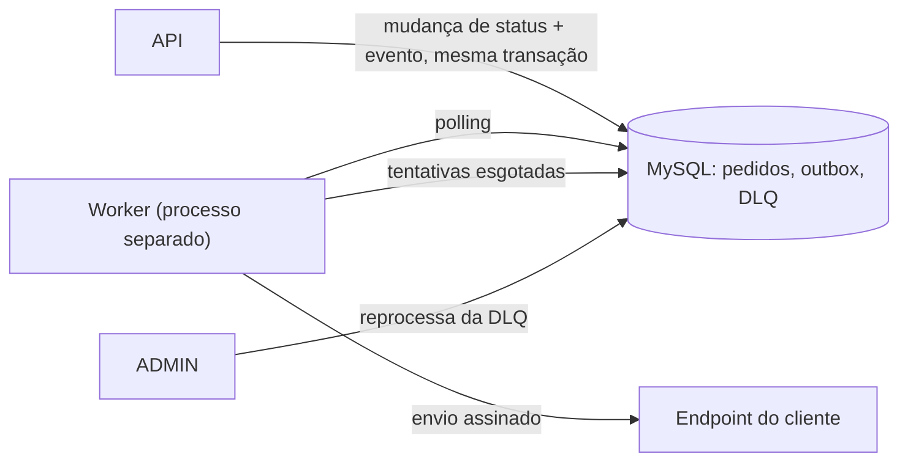

# RFC: Sistema de Webhooks de Notificação de Pedidos

## Metadados

| Campo | Valor |
| --- | --- |
| Autor | Elder Gil (redação a partir da reunião técnica) |
| Status | Em revisão |
| Data | 14/10/2026 |
| Reunião de origem | Quinta-feira, 09:00, cerca de 55 minutos ([`TRANSCRICAO.md`](../TRANSCRICAO.md)) |
| Revisores | Larissa (Tech Lead), Marcos (Product Manager), Bruno (Engenheiro Pleno, Pedidos), Diego (Engenheiro Sênior, Plataforma), Sofia (Engenheira de Segurança) |
| Documentos relacionados | [PRD](PRD.md), [FDD](FDD.md), [ADRs](adrs/README.md), [Tracker](TRACKER.md) |

## Resumo (TL;DR)

Propomos avisar os clientes B2B por webhook quando o status de um pedido mudar. O evento é gravado numa outbox no MySQL, na mesma transação da mudança de status. Um worker em processo separado lê a outbox por polling e faz a chamada HTTP. Se o cliente falhar, há retry com backoff exponencial e, depois, uma DLQ com reprocessamento manual. Cada envio é assinado com HMAC-SHA256, com secret por endpoint, e leva um id de evento para o cliente deduplicar, porque a garantia é at-least-once. Nada exige infraestrutura nova: o módulo segue os padrões do projeto.

Sete pontos ficaram adiados ou sem decisão na reunião, e a análise encontrou outras cinco lacunas. As duas listas estão no fim deste documento.

## Contexto e problema

Três clientes B2B, Atlas Comercial, MaxDistribuição e Nova Cargo, pediram formalmente para ser notificados quando o status dos pedidos deles muda ([09:00] Marcos). Hoje eles consultam GET /orders de tempos em tempos, o que deixa a integração lenta e cara ([09:00] Marcos), e a Atlas sinalizou que pode migrar para um concorrente ([09:00] Marcos). Para eles, abaixo de 10 segundos já é tempo real ([09:02] Marcos). O fluxo é só de saída ([09:02] Marcos).

A aplicação não tem nenhum mecanismo de notificação, evento ou fila. A mudança de status acontece em `OrderService.changeStatus` (`src/modules/orders/order.service.ts`), numa transação que já atualiza o pedido, grava o histórico e mexe no estoque ([09:04] Bruno). A solução precisa conviver com essa transação sem deixar um cliente lento ou fora do ar travar a operação principal ([09:04] Bruno).

## Proposta técnica

1. **Outbox transacional.** O evento é gravado na transação de `changeStatus`; se a gravação falhar, a mudança de status faz rollback. O payload é montado nesse momento, como fotografia do pedido. Ver [ADR-001](adrs/ADR-001-outbox-no-mysql.md) e [ADR-007](adrs/ADR-007-snapshot-do-payload-na-insercao.md).
2. **Worker separado.** Uma entry-point nova, fora da API, lê os eventos pendentes por polling. Um único worker mantém a ordem por pedido; não há ordem global. Ver [ADR-002](adrs/ADR-002-worker-em-processo-separado-com-polling.md).
3. **Retry e DLQ.** Falha ou timeout entram em retry com backoff exponencial; esgotadas as tentativas, o evento vai para uma tabela de dead letter, de onde um ADMIN reprocessa. Ver [ADR-003](adrs/ADR-003-retry-com-backoff-exponencial-e-dlq.md).
4. **Assinatura e entrega.** HMAC-SHA256 com secret por endpoint, gerada pela plataforma e rotacionável; id de evento estável para deduplicação. Ver [ADR-004](adrs/ADR-004-hmac-sha256-com-secret-por-endpoint.md) e [ADR-005](adrs/ADR-005-entrega-at-least-once-com-x-event-id.md).
5. **Módulo no padrão do projeto.** Cadastro, histórico de entregas e reprocessamento num módulo novo, com os mesmos erros, logger, validação e controle de role da API. Ver [ADR-006](adrs/ADR-006-reuso-dos-padroes-do-projeto.md).

Rotas, payload, headers, tabelas e matriz de erros estão no [FDD](FDD.md).

## Alternativas consideradas

| Alternativa | Por que foi descartada na reunião | ADR |
| --- | --- | --- |
| Disparo síncrono no service de orders | A transação já é pesada e um cliente lento travaria a mudança de status de outros pedidos; com o cliente fora do ar, não dá para desfazer a mudança ([09:04] Bruno). Diego declarou síncrono "fora de questão" ([09:06] Diego) | [ADR-001](adrs/ADR-001-outbox-no-mysql.md) |
| Fila em Redis Streams | Exigiria subir mais infraestrutura ([09:07] Larissa); para um time pequeno, é overengineering ([09:07] Diego) | [ADR-001](adrs/ADR-001-outbox-no-mysql.md) |
| Trigger do banco para acordar o worker, proposta por Bruno ([09:09] Bruno) | O MySQL não notifica processo externo, seria preciso improvisar, e o polling já atende o limite de 10 s ([09:09] Diego) | [ADR-002](adrs/ADR-002-worker-em-processo-separado-com-polling.md) |
| Retry indefinido | O evento fica pendurado para sempre se o cliente sumir ([09:15] Diego) | [ADR-003](adrs/ADR-003-retry-com-backoff-exponencial-e-dlq.md) |
| Três tentativas, proposta por Bruno ([09:16] Bruno) | Pouca janela: já houve cliente com duas horas de manutenção planejada ([09:16] Diego) | [ADR-003](adrs/ADR-003-retry-com-backoff-exponencial-e-dlq.md) |
| DLQ como status "failed" na outbox | A tabela separada deixa a outbox mais limpa e guarda evidência para debug e reprocessamento ([09:18] Diego) | [ADR-003](adrs/ADR-003-retry-com-backoff-exponencial-e-dlq.md) |
| Secret global da plataforma | Se vaza uma, vaza tudo ([09:21] Sofia) | [ADR-004](adrs/ADR-004-hmac-sha256-com-secret-por-endpoint.md) |
| Garantia exactly-once | Exige coordenação dos dois lados e é muito mais complexo ([09:25] Diego) | [ADR-005](adrs/ADR-005-entrega-at-least-once-com-x-event-id.md) |
| Montar o payload na hora do envio | O evento deixaria de refletir o estado do momento da mudança ([09:52] Larissa) | [ADR-007](adrs/ADR-007-snapshot-do-payload-na-insercao.md) |

## Questões em aberto

### Levantadas na reunião e adiadas ou não decididas

1. **Quantos envios são feitos.** Larissa fechou "5 tentativas, backoff 1m/5m/30m/2h/12h" ([09:17] Larissa) e repetiu "total 5 tentativas" ([09:48] Larissa). Mas são cinco intervalos, e Diego disse que eles dão "quase 15 horas entre primeira falha e última tentativa" ([09:17] Diego), o que só fecha com 1 envio inicial mais 5 retentativas, ou seja, 6 envios. Até a confirmação, o FDD adota 1 + 5 como premissa provisória. **Para:** Larissa e Diego.
2. **Rate limiting de saída.** Diego levantou o caso de 50 mudanças em um minuto virarem 50 chamadas para o mesmo cliente ([09:38] Diego). Ficou "observar e decidir depois" ([09:39] Larissa). O FDD prevê uma métrica de envios por webhook para a decisão ser tomada com dado.
3. **Escalar para vários workers.** Com mais de um worker, a ordem por pedido se perde. As saídas citadas foram particionar por order_id ou usar lock pessimista, deixadas para o futuro ([09:13] Diego).
4. **Endurecer o acesso ao CRUD de webhooks.** Por enquanto, qualquer role autenticada pode cadastrar e editar ([09:37] Sofia). No código, `User` não tem vínculo com `Customer` (`prisma/schema.prisma`) e as roles são só ADMIN e OPERATOR (`src/middlewares/auth.middleware.ts`), então hoje não há como restringir um usuário aos webhooks de um customer.
5. **Aviso ao cliente quando o webhook falha.** E-mail depois de falhas seguidas ficou "talvez próxima fase, depois que a gente medir o impacto" ([09:37] Larissa).
6. **Arquivamento da outbox.** As linhas entregues seriam arquivadas "depois de 30 dias ou assim", fora do escopo desta feature ([09:08] Diego).
7. **Onde vai o customer_id no cadastro.** Ficou "no body ou no path" ([09:32] Larissa). O FDD propõe uma das formas.

### Lacunas identificadas na análise (não discutidas na reunião)

Estes pontos não foram tratados na reunião. Aparecem aqui para revisão, não como decisão.

- **Linhas de outbox quando vários webhooks querem o mesmo evento.** Um customer pode ter vários endpoints ([09:44] Sofia), o filtro é na inserção ([09:34] Bruno) e o id é único por evento ([09:25] Diego), mas a reunião não disse se o evento gera uma linha ou uma por webhook. O FDD propõe uma linha por webhook com o mesmo id de evento, para isolar retry e DLQ de cada endpoint. Validar na sessão de revisão que Larissa marcou com Bruno e Diego ([09:50] Larissa).
- **Secret usada durante as 24 h de rotação.** A antiga "fica válida por 24 horas em paralelo" ([09:21] Sofia), mas não se disse se a plataforma assina com a nova, com a antiga ou com as duas. Para a revisão de segurança de Sofia ([09:46] Sofia).
- **Timestamp fora da assinatura.** O HMAC é sobre o corpo ([09:22] Sofia), e o X-Timestamp foi pensado para detectar replay attack ([09:44] Diego). Sem o timestamp na assinatura, quem capturar a requisição pode trocá-lo. Para a revisão de segurança de Sofia.
- **Armazenamento da secret.** Ela precisa ser recuperável a cada envio para assinar, então não pode ficar só como hash. A forma de guardar não foi discutida. Para a revisão de segurança de Sofia.
- **Evento na criação do pedido.** A reunião falou de mudança de status ([09:00] Marcos) e de `changeStatus` ([09:40] Bruno). O pedido nasce em `OrderService.create()`, com status PENDING e uma linha de histórico. O FDD propõe que a criação não gere evento.

## Impacto e riscos

**Impacto no sistema atual.** A transação de `changeStatus` passa a gravar o evento, e uma falha nessa gravação impede a mudança de status, que é o comportamento desejado ([09:40] Bruno). Entra em produção um processo novo, o worker ([09:11] Diego). A outbox cresce sem arquivamento nesta fase ([09:08] Diego).

| Risco | Mitigação |
| --- | --- |
| Entrega duplicada: o cliente processa o mesmo evento duas vezes | Id de evento e documentação em destaque no portal ([09:26] Marcos) |
| Ordem perdida com retry: um evento em backoff é ultrapassado pelo seguinte do mesmo pedido (análise, não fala da reunião) | Tratamento proposto no FDD |
| Latência acima de 10 s: polling ([09:10] Larissa) somado a um envio lento, até o timeout de 10 s ([09:42] Diego) | Medir a latência por envio (FDD) e acompanhar contra a meta do PRD |
| Secret em log: o redact do logger (`src/shared/logger/index.ts`) não cobre a secret | Ajuste do redact no FDD |
| Prazo: a Atlas citou fim do trimestre ([09:00] Marcos) e depois fim de novembro ([09:45] Marcos); a estimativa é de três sprints com revisão de segurança ([09:47] Larissa) | Marcos confirma o prazo com a Atlas ([09:47] Marcos); Sofia reserva pelo menos dois dias úteis de revisão ([09:46] Sofia) |

## Decisões relacionadas

[ADR-001](adrs/ADR-001-outbox-no-mysql.md) Outbox no MySQL · [ADR-002](adrs/ADR-002-worker-em-processo-separado-com-polling.md) Worker separado com polling · [ADR-003](adrs/ADR-003-retry-com-backoff-exponencial-e-dlq.md) Retry e DLQ · [ADR-004](adrs/ADR-004-hmac-sha256-com-secret-por-endpoint.md) HMAC com secret por endpoint · [ADR-005](adrs/ADR-005-entrega-at-least-once-com-x-event-id.md) At-least-once com X-Event-Id · [ADR-006](adrs/ADR-006-reuso-dos-padroes-do-projeto.md) Reuso dos padrões · [ADR-007](adrs/ADR-007-snapshot-do-payload-na-insercao.md) Snapshot do payload
